# ▲ Next.js — Student Notes
## Units I – IV | JavaScript Edition (Next.js 16, App Router)

> 📘 **How to use these notes**
> Every topic has a short explanation, a picture, and a **small working example**. Type the code yourself, run it, then change it and see what happens.
>
> | Icon | Meaning |
> |---|---|
> | 🧪 | Try it yourself |
> | 💡 | Tip |
> | ⚠️ | Common mistake / warning |
> | 🧠 | Remember this |

### ✅ Before You Start

| Requirement | Check with | Needed |
|---|---|---|
| Node.js | `node -v` | **20.9 or newer** |
| npm | `npm -v` | any recent version |
| Code editor | VS Code | recommended |
| Internet | — | for `npm install` and sample APIs |

> 💡 All code in these notes is **plain JavaScript** (`.js` files). When `create-next-app` asks *"Would you like to use TypeScript?"* answer **No**.

### 🗺️ What You Will Learn

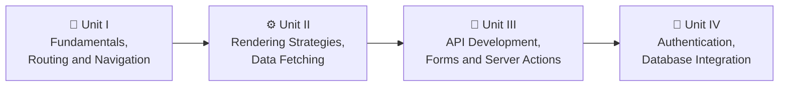

---

### 📑 Contents

| Unit | Topics |
|---|---|
| **I** | Introduction · Features · Installation · Project Structure · App Router · Development Workflow · File-based Routing · Dynamic Routes · Nested Routes · Layouts · Navigation · Loading and Error UI · Mini Blog Project |
| **II** | SSG · SSR · ISR · CSR · Choosing a Strategy · Server Components · Client Components · Fetch API · Server-side Fetching · Client-side Fetching · Caching and Revalidation |
| **III** | Route Handlers · REST APIs · HTTP Methods · Dynamic Route Handlers · Request/Response Handling · Server Actions · Form Handling · Form Validation · File Upload · Data Mutations · Optimistic UI |
| **IV** | Authentication Concepts · Session Management · Protected Routes · Authorization · Role-based Access Control · ORM Basics · Environment Variables · Database Connectivity · CRUD with Mongoose · Data Validation |

---

# 📘 UNIT I — Fundamentals of Next.js, Routing & Navigation

---

## 1. Introduction to Next.js

### 1.1 What is Next.js? 🤔

**React** is a library for building user interfaces (components). But a real website also needs **routing, a build system, server rendering, API endpoints, image optimization, SEO tags...**

**Next.js is a React framework** that gives you all of these, ready to use.

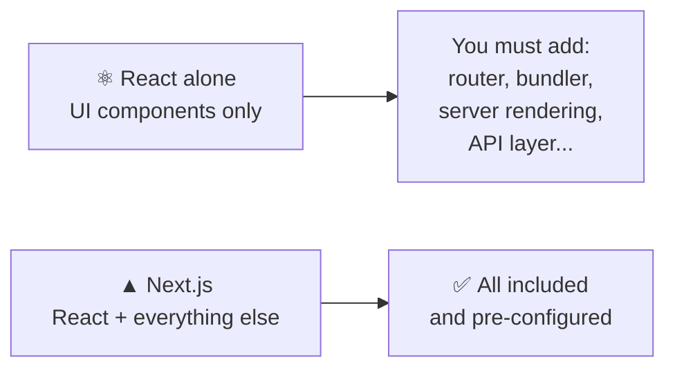

| | Plain React (e.g. Vite) | Next.js |
|---|---|---|
| Routing | Install and configure `react-router` | **Folders = routes** (built in) |
| Rendering | Browser only (CSR) | Server, static, and browser — **you choose per page** |
| Backend / API | Separate server needed | **Route Handlers** inside the same project |
| SEO | Hard (empty HTML first) | Easy (HTML is ready from the server) |
| Image / font optimization | Manual | Built in |

> 🧠 **One line to remember:** *Next.js = React + routing + server rendering + backend, in one project.*

### 1.2 Features of Next.js ✨

| Feature | What it means | Example |
|---|---|---|
| 📁 **File-based routing** | Create a folder → get a URL | `app/about/page.js` → `/about` |
| 🖥️ **Server Components** | Components that run on the server, send only HTML | Fetch data directly in a component |
| ⚡ **Multiple rendering modes** | Static, server-side, incremental, client-side | Unit II |
| 🔌 **Route Handlers** | Write API endpoints | `app/api/hello/route.js` |
| 📝 **Server Actions** | Call server functions from forms | Unit III |
| 🖼️ **Image optimization** | Auto resize, lazy load, modern formats | `<Image />` |
| 🔤 **Font optimization** | Self-hosts fonts, no layout jump | `next/font` |
| 🏷️ **Metadata API** | Page title and SEO tags | `export const metadata` |
| 🚀 **Turbopack** | Very fast dev server and builds (default) | `npm run dev` |
| 🛡️ **Proxy** | Run code before a request finishes (redirects, auth checks) | `proxy.js` |

### 🧪 Mini examples of two built-in features

**Page title (Metadata API)** — in any `layout.js` or `page.js`:
```jsx
export const metadata = {
  title: 'My First Next.js Site',
  description: 'Learning Next.js at LPU',
};
```

**Optimized image** — put `logo.png` inside the `public/` folder:
```jsx
import Image from 'next/image';

export default function Logo() {
  return <Image src="/logo.png" alt="Site logo" width={200} height={80} />;
}
```
> ⚠️ `width` and `height` are required for local images — they prevent the page from "jumping" while the image loads.

---

## 2. Installing and Running Your First Project

```bash
npx create-next-app@latest my-app
```

Answer the questions like this:

| Question | Answer |
|---|---|
| TypeScript? | **No** |
| ESLint? | Yes |
| App Router? | **Yes** |
| `src/` directory? | No (keeps these notes simple) |
| Import alias `@/*`? | Yes |
| Tailwind CSS / React Compiler | No (optional) |

```bash
cd my-app
npm run dev
```
Open **http://localhost:3000** — you should see the starter page. 🎉

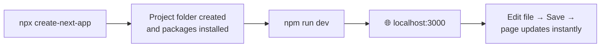

---

## 3. Project Structure 📁

```
my-app/
├── app/                  ← 📄 your pages, layouts and API routes live here
│   ├── layout.js         ← shared shell for every page (required)
│   ├── page.js           ← the home page  ( / )
│   ├── globals.css       ← global styles
│   └── favicon.ico
├── public/               ← 🖼️ static files, served from "/" (images, robots.txt)
├── node_modules/         ← 📦 installed packages (never edit, never commit)
├── .next/                ← 🏗️ build output (auto-generated, never edit)
├── package.json          ← 📋 scripts and dependencies
├── next.config.mjs       ← ⚙️ Next.js settings (file may be .js or .mjs)
├── jsconfig.json         ← lets you write  '@/lib/...'  imports
└── .gitignore
```

| Item | Purpose |
|---|---|
| `app/` | **Everything the user can visit.** Folder names become URLs |
| `app/layout.js` | Wraps every page — put navbar/footer here |
| `app/page.js` | UI for the route `/` |
| `public/` | `public/logo.png` is available at `/logo.png` |
| `next.config.*` | Advanced settings (redirects, image domains, ...) |
| `package.json` | `npm run dev / build / start / lint` |

### 🧪 Your first edit
Open `app/page.js`, delete everything, and write:
```jsx
export default function Home() {
  return (
    <main>
      <h1>👋 Hello, Next.js!</h1>
      <p>This is my home page.</p>
    </main>
  );
}
```
Save — the browser updates **without a reload**.

---

## 4. The App Router

The **App Router** is the modern Next.js routing system. It is based on the `app/` folder.

> 🧠 **Rule 1:** a **folder** is a URL segment.
> 🧠 **Rule 2:** a folder becomes a **public page** only if it contains a **`page.js`** file.

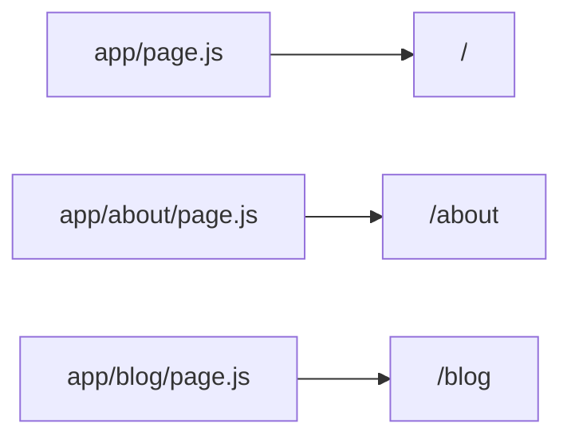

### 4.1 Special files (file conventions)

| File | What it does |
|---|---|
| `page.js` | The page UI — makes the route public |
| `layout.js` | UI shared by a page and all pages below it |
| `loading.js` | Shown while the page is loading |
| `error.js` | Shown when the page crashes |
| `not-found.js` | Shown for 404 |
| `route.js` | An API endpoint (instead of a page) — Unit III |

### 4.2 Server Components vs Client Components ⚖️

In the App Router, **every component is a Server Component by default**.

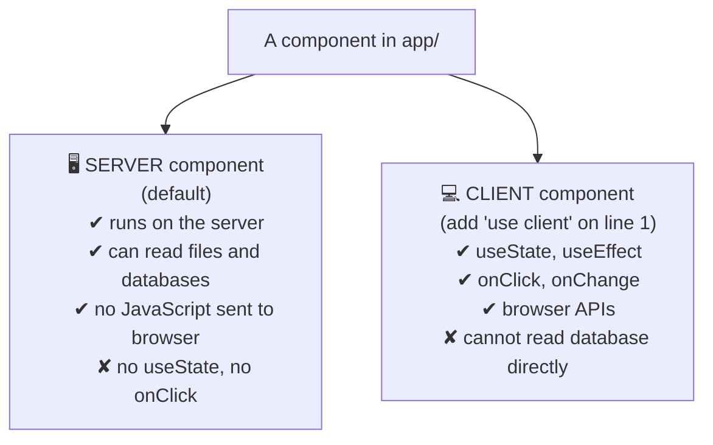

| | Server Component | Client Component |
|---|---|---|
| How to make | Nothing — default | First line: `'use client'` |
| Runs on | Server only | Server (first HTML) **and** browser |
| `useState`, `useEffect` | ❌ | ✅ |
| `onClick`, `onChange` | ❌ | ✅ |
| `async/await` in component | ✅ | ❌ |
| Access database / secrets | ✅ | ❌ |

### 🧪 Example — a Server page with a Client button

**`app/components/Counter.js`** (Client Component):
```jsx
'use client';                       // 👈 must be the very first line

import { useState } from 'react';

export default function Counter() {
  const [count, setCount] = useState(0);

  return (
    <button onClick={() => setCount(count + 1)}>
      Clicked {count} times
    </button>
  );
}
```

**`app/page.js`** (Server Component):
```jsx
import Counter from './components/Counter';

export default function Home() {
  console.log('Hello from the SERVER');   // appears in the TERMINAL, not the browser

  return (
    <main>
      <h1>Server + Client together</h1>
      <Counter />
    </main>
  );
}
```

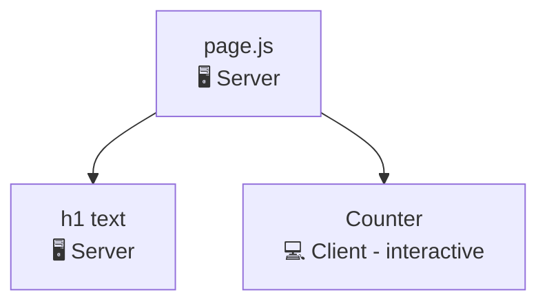

> ⚠️ **Most common beginner error:**
> *"You're importing a component that needs useState. It only works in a Client Component..."*
> → Add `'use client'` at the top of that file.

> 💡 **Best practice:** keep most of the page as Server Components. Make only the small interactive parts (buttons, forms, inputs) Client Components.

---

## 5. Development Workflow 🔄

### 5.1 The four commands

| Command | What it does | When |
|---|---|---|
| `npm run dev` | Start dev server with **Fast Refresh** (instant updates) | While coding |
| `npm run build` | Create an optimized **production build** | Before deploying |
| `npm start` | Run the production build | Test the real behaviour |
| `npm run lint` | Check code with ESLint | Before committing |

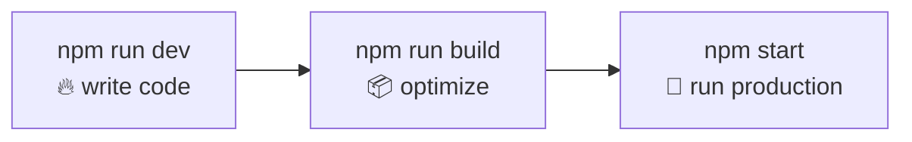

### 5.2 Dev vs Production — important! ⚠️

| | `npm run dev` | `npm run build` + `npm start` |
|---|---|---|
| Speed | Updates instantly | Slower to build, fast to run |
| Pages | Rendered **fresh on every request** | Static pages are **built once** |
| Errors | Big helpful overlay | Short messages |
| Use for | Coding | **Testing caching/rendering (Unit II)** |

### 5.3 Reading the build output

After `npm run build` you will see a table like this (example):
```
Route (app)
┌ ○ /
├ ○ /about
├ ƒ /dashboard
└ ● /blog/[slug]

○  (Static)   prerendered as static content
●  (SSG)      prerendered as static HTML (uses generateStaticParams)
ƒ  (Dynamic)  server-rendered on demand
```
| Symbol | Meaning |
|---|---|
| ○ | Page built **once** at build time |
| ● | Dynamic route whose pages are pre-built |
| ƒ | Page built **on every request** |

### 5.4 Handy habits
- **Change the port:** `npm run dev -- -p 4000`
- **Stop the server:** `Ctrl + C`
- **Weird behaviour?** Stop server → delete the `.next` folder → run again.
- **Never edit** `.next/` or `node_modules/`.
- Environment variables go in `.env.local` (covered in Unit IV).

---

# 🛣️ Routing and Navigation

---

## 6. File-based Routing

No router setup. **Create folders and `page.js` files — Next.js builds the routes.**

```
app/
├── page.js                → /
├── about/
│   └── page.js            → /about
├── contact/
│   └── page.js            → /contact
└── blog/
    └── page.js            → /blog
```

### 🧪 Example — an About page
**`app/about/page.js`**
```jsx
export default function AboutPage() {
  return (
    <main>
      <h1>About Us</h1>
      <p>We are learning Next.js.</p>
    </main>
  );
}
```
Visit **http://localhost:3000/about** ✅

> ⚠️ The component must be a **default export**. The file must be named exactly `page.js`.

---

## 7. Dynamic Routes

Wrap a folder name in **square brackets** to capture any value from the URL.

```
app/
└── blog/
    └── [slug]/
        └── page.js        → /blog/anything-here
```

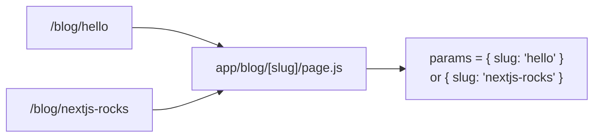

### 🧪 Example
**`app/blog/[slug]/page.js`**
```jsx
export default async function BlogPost({ params }) {
  const { slug } = await params;        // 👈 params is a Promise in Next.js 15/16

  return <h1>Reading post: {slug}</h1>;
}
```
`/blog/hello` → **Reading post: hello**

> ⚠️ **Important (Next.js 15+):** `params` is a **Promise**. You must write `await params` (and make the function `async`). Old tutorials use `params.slug` directly — that no longer works.

### 7.1 Query strings with `searchParams`
`/search?q=react` → the page also receives `searchParams` (also a Promise):
```jsx
export default async function SearchPage({ searchParams }) {
  const { q } = await searchParams;
  return <h1>You searched for: {q}</h1>;
}
```

### 7.2 Catch-all routes

| Folder | Matches | `params` |
|---|---|---|
| `[slug]` | `/blog/a` | `{ slug: 'a' }` |
| `[...slug]` | `/docs/a`, `/docs/a/b/c` | `{ slug: ['a','b','c'] }` |
| `[[...slug]]` | `/docs` **and** `/docs/a/b` | `{ slug: undefined }` or array |

```jsx
// app/docs/[...slug]/page.js
export default async function Docs({ params }) {
  const { slug } = await params;            // e.g. ['react', 'hooks']
  return <h1>Path: {slug.join(' / ')}</h1>;
}
```

---

## 8. Nested Routes

Put folders **inside** folders. Each level adds a segment to the URL.

```
app/
└── dashboard/
    ├── page.js              → /dashboard
    ├── settings/
    │   └── page.js          → /dashboard/settings
    └── profile/
        └── page.js          → /dashboard/profile
```

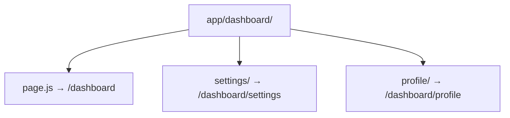

### 🧪 Example
**`app/dashboard/settings/page.js`**
```jsx
export default function Settings() {
  return <h1>⚙️ Dashboard Settings</h1>;
}
```

### 8.1 Two handy folder tricks

| Trick | Folder name | Effect |
|---|---|---|
| **Route group** | `(marketing)` | Organizes files but is **not part of the URL** |
| **Private folder** | `_components` | Folder is ignored by routing |

```
app/
├── (marketing)/
│   └── pricing/page.js     → /pricing        (no "marketing" in URL)
└── _components/
    └── Button.js            (never becomes a route)
```

---

## 9. Layouts

A **layout** is UI shared by many pages. It receives the current page as `children`.

### 9.1 Root layout (required)
**`app/layout.js`**
```jsx
import './globals.css';

export const metadata = {
  title: 'My Site',
  description: 'Built with Next.js',
};

export default function RootLayout({ children }) {
  return (
    <html lang="en">
      <body>
        <header>🧭 My Navbar</header>
        {children}                     {/* 👈 current page appears here */}
        <footer>© 2026 LPU</footer>
      </body>
    </html>
  );
}
```
> ⚠️ The root layout **must** contain `<html>` and `<body>`.

### 9.2 Nested layouts
A layout inside a folder wraps only that folder's pages — and sits **inside** the parent layout.

**`app/dashboard/layout.js`**
```jsx
export default function DashboardLayout({ children }) {
  return (
    <div style={{ display: 'flex', gap: 24 }}>
      <aside>
        <p>📊 Dashboard menu</p>
        <ul>
          <li>Overview</li>
          <li>Settings</li>
        </ul>
      </aside>
      <section>{children}</section>
    </div>
  );
}
```

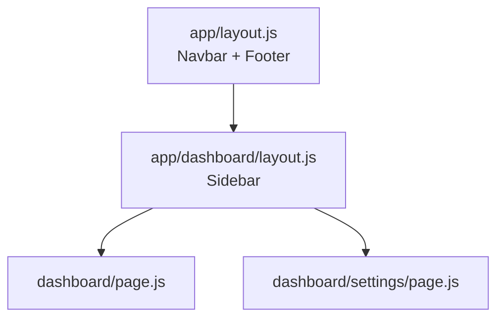

> 🧠 **Layouts do not re-render when you move between their pages.** The navbar and sidebar keep their state and don't flicker.

---

## 10. Navigation

### 10.1 The `<Link>` component
Use `<Link>` instead of `<a>` for pages inside your app. It switches pages **without reloading the browser** and **prefetches** the next page.

```jsx
import Link from 'next/link';

export default function Menu() {
  return (
    <nav>
      <Link href="/">Home</Link>
      <Link href="/about">About</Link>
      <Link href="/blog/hello">First post</Link>
    </nav>
  );
}
```

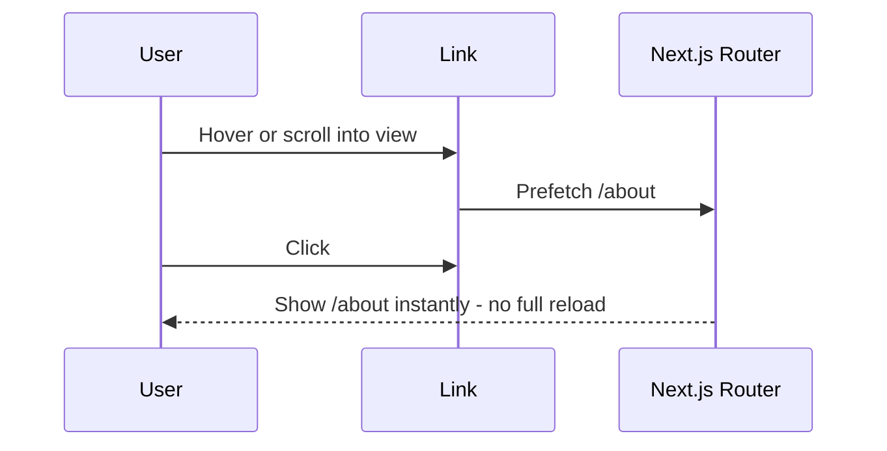

| | `<a href>` | `<Link href>` |
|---|---|---|
| Page reload | ✅ Full reload | ❌ No reload |
| Prefetch | ❌ | ✅ |
| Keeps layout state | ❌ | ✅ |

### 10.2 Highlight the active link
Reading the current URL needs the browser, so this is a **Client Component**:

**`app/components/Navbar.js`**
```jsx
'use client';

import Link from 'next/link';
import { usePathname } from 'next/navigation';

const links = [
  { href: '/', label: 'Home' },
  { href: '/blog', label: 'Blog' },
  { href: '/dashboard', label: 'Dashboard' },
];

export default function Navbar() {
  const pathname = usePathname();          // e.g. "/blog"

  return (
    <nav style={{ display: 'flex', gap: 16 }}>
      {links.map((link) => (
        <Link
          key={link.href}
          href={link.href}
          style={{ fontWeight: pathname === link.href ? 'bold' : 'normal' }}
        >
          {link.label}
        </Link>
      ))}
    </nav>
  );
}
```
Then use `<Navbar />` inside `app/layout.js`.

### 10.3 Navigate with code

| Where | Tool | Example |
|---|---|---|
| Client Component (after a click) | `useRouter()` | `router.push('/blog')` |
| Server Component / Server Action | `redirect()` | `redirect('/login')` |

```jsx
'use client';
import { useRouter } from 'next/navigation';

export default function GoButton() {
  const router = useRouter();
  return <button onClick={() => router.push('/dashboard')}>Go to dashboard</button>;
}
```
```jsx
// In a Server Component
import { redirect } from 'next/navigation';

export default function OldPage() {
  redirect('/new-page');
}
```
Other router methods: `router.back()`, `router.forward()`, `router.replace(url)`, `router.refresh()`.

> ⚠️ Import `useRouter` from **`next/navigation`** (App Router), not `next/router`.

---

## 11. Loading UI and Error UI

Next.js lets you handle **loading**, **errors** and **404** with simple files — no `if` statements needed.

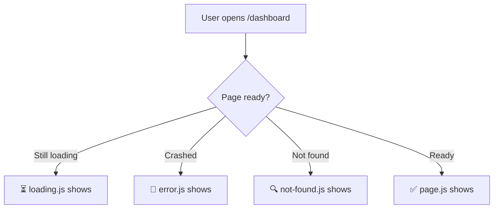

### 11.1 Loading UI — `loading.js`
Put it next to `page.js`. It appears automatically while the page waits for data.

**`app/dashboard/loading.js`**
```jsx
export default function Loading() {
  return <p>⏳ Loading dashboard...</p>;
}
```
**`app/dashboard/page.js`** *(simulate a slow page)*
```jsx
export default async function Dashboard() {
  await new Promise((resolve) => setTimeout(resolve, 2000));   // wait 2 seconds
  return <h1>📊 Dashboard is ready!</h1>;
}
```
Open `/dashboard` — you see the loading message for 2 seconds, then the page.

### 11.2 Error UI — `error.js`
Catches errors in that route and shows a friendly message **instead of crashing the whole site**.

**`app/dashboard/error.js`**
```jsx
'use client';                           // error.js MUST be a Client Component

export default function Error({ error, reset }) {
  return (
    <div>
      <h2>🚨 Something went wrong!</h2>
      <p>{error.message}</p>
      <button onClick={() => reset()}>🔄 Try again</button>
    </div>
  );
}
```
🧪 Test it — temporarily add `throw new Error('Boom!');` inside `Dashboard()`.

> 💡 `reset()` tries to render the page again. In **production**, the real error message is hidden from users for safety (they see a generic message).

### 11.3 Not found — `not-found.js` and `notFound()`

**`app/not-found.js`** *(global 404 page)*
```jsx
import Link from 'next/link';

export default function NotFound() {
  return (
    <main>
      <h1>404 — Page not found</h1>
      <Link href="/">Go home</Link>
    </main>
  );
}
```
Trigger it yourself when data is missing:
```jsx
import { notFound } from 'next/navigation';

export default async function Post({ params }) {
  const { slug } = await params;
  const post = getPost(slug);
  if (!post) notFound();                 // shows the nearest not-found.js
  return <h1>{post.title}</h1>;
}
```

---

## 12. 🧪 Mini Project — Blog Site (puts Unit I together)

**Folder plan**
```
app/
├── layout.js              ← navbar for the whole site
├── page.js                ← home
├── not-found.js
├── components/
│   └── Navbar.js          ← (from section 10.2)
├── blog/
│   ├── page.js            ← list of posts
│   └── [slug]/
│       └── page.js        ← single post
└── dashboard/
    ├── layout.js          ← sidebar
    ├── loading.js
    ├── error.js
    └── page.js
lib/
└── posts.js               ← our "database"
```

**`lib/posts.js`**
```js
export const posts = [
  { slug: 'hello-nextjs', title: 'Hello Next.js', body: 'Next.js makes React easier.' },
  { slug: 'app-router', title: 'Understanding the App Router', body: 'Folders become routes.' },
  { slug: 'server-components', title: 'Server Components', body: 'They run only on the server.' },
];

export function getPost(slug) {
  return posts.find((post) => post.slug === slug);
}
```

**`app/layout.js`**
```jsx
import Navbar from './components/Navbar';

export const metadata = { title: 'LPU Blog', description: 'Next.js practice site' };

export default function RootLayout({ children }) {
  return (
    <html lang="en">
      <body style={{ fontFamily: 'sans-serif', maxWidth: 800, margin: '0 auto', padding: 16 }}>
        <Navbar />
        <hr />
        {children}
      </body>
    </html>
  );
}
```

**`app/page.js`**
```jsx
import Link from 'next/link';

export default function Home() {
  return (
    <main>
      <h1>Welcome to the LPU Blog 👋</h1>
      <Link href="/blog">Read the posts →</Link>
    </main>
  );
}
```

**`app/blog/page.js`**
```jsx
import Link from 'next/link';
import { posts } from '@/lib/posts';

export default function BlogList() {
  return (
    <main>
      <h1>📚 Blog</h1>
      <ul>
        {posts.map((post) => (
          <li key={post.slug}>
            <Link href={`/blog/${post.slug}`}>{post.title}</Link>
          </li>
        ))}
      </ul>
    </main>
  );
}
```

**`app/blog/[slug]/page.js`**
```jsx
import Link from 'next/link';
import { notFound } from 'next/navigation';
import { getPost } from '@/lib/posts';

export default async function BlogPost({ params }) {
  const { slug } = await params;
  const post = getPost(slug);

  if (!post) notFound();

  return (
    <article>
      <h1>{post.title}</h1>
      <p>{post.body}</p>
      <Link href="/blog">← Back to all posts</Link>
    </article>
  );
}
```

**`app/dashboard/layout.js`**, **`loading.js`**, **`error.js`**, **`page.js`** → use the code from sections 9.2 and 11.

✅ **Test list:** `/` · `/blog` · `/blog/hello-nextjs` · `/blog/unknown` (404) · `/dashboard` (loading, then page) · click links (no page reload).

---

## 📌 Unit I — Quick Revision

| Topic | Remember |
|---|---|
| Next.js | React framework: routing + rendering + backend |
| `app/` folder | Folders = URLs; `page.js` makes a route public |
| Server vs Client | Server by default; add `'use client'` for state/events |
| Dynamic route | `[slug]` → `const { slug } = await params` |
| Layout | Shared UI, wraps `children`, does not re-render on navigation |
| Navigation | `<Link>`, `useRouter().push()`, `redirect()` |
| `loading.js` / `error.js` / `not-found.js` | Loading, crash, and 404 screens |
| Dev vs production | Test caching with `npm run build` + `npm start` |

### ❓ Common Errors

| Error / Symptom | Cause | Fix |
|---|---|---|
| 404 on a new route | File not named `page.js`, or not a default export | Rename / `export default` |
| "needs useState... Client Component" | Hooks in a Server Component | Add `'use client'` |
| `params.slug` is undefined / warning | `params` is a Promise | `const { slug } = await params` |
| `error.js` does nothing | Missing `'use client'` | Add it on line 1 |
| Page full-reloads on click | Used `<a>` | Use `<Link>` |
| `useRouter` error | Imported from `next/router` | Import from `next/navigation` |

---

# ⚙️ UNIT II — Rendering Strategies & Data Fetching

---

# 🖥️ Rendering Strategies

## 1. What is "Rendering"?

**Rendering = turning your React components into HTML that the browser can show.**

The big question for every page is: **WHEN and WHERE is that HTML created?**

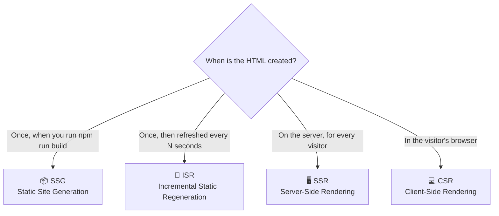

| Strategy | HTML created... | Speed | Data freshness |
|---|---|---|---|
| **SSG** | At build time | ⚡⚡⚡ fastest | Fixed until next build |
| **ISR** | At build, then re-built in background | ⚡⚡⚡ fast | Fresh every N seconds |
| **SSR** | On every request | ⚡ depends on server | Always fresh |
| **CSR** | In the browser after JS loads | ⚡ slow first paint | Fresh, loaded by JS |

### 🧠 How does Next.js decide?
You don't switch a "mode" on. **Next.js looks at what your page uses:**

| Your page uses... | Result |
|---|---|
| Nothing dynamic | **Static** (SSG) |
| `cookies()`, `headers()`, `await searchParams`, `cache: 'no-store'`, `dynamic = 'force-dynamic'` | **Dynamic** (SSR) |
| `revalidate = N` or `fetch(..., { next: { revalidate: N } })` | **Static + refresh** (ISR) |
| `'use client'` + `useEffect` fetch | Data loaded in browser (CSR) |

### 🧪 Set up the experiment
We will build **four pages that all print the current time**. The time tells us *when* the HTML was created.

> ⚠️ **Rendering behaviour only shows correctly in production mode.**
> `npm run dev` re-renders everything on every request. So for these experiments always run:
> ```bash
> npm run build
> npm start
> ```
> (Stop with `Ctrl + C`, rebuild after every code change.)

---

## 2. Static Site Generation (SSG)

The page is built **once at build time** and served as a ready-made HTML file. Every visitor gets the same file — super fast and cheap.

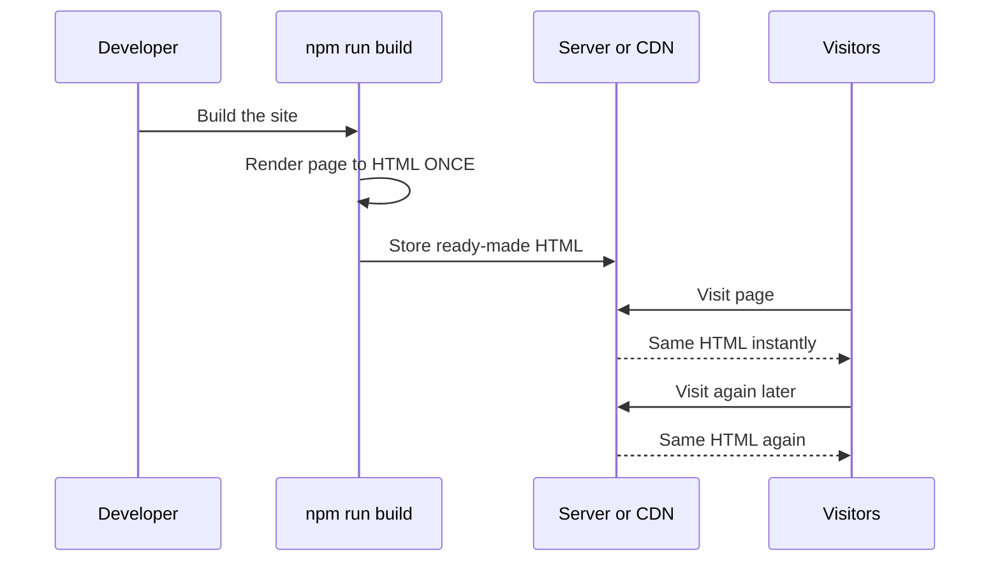

### 🧪 Example
**`app/rendering/ssg/page.js`**
```jsx
export default function SsgPage() {
  const builtAt = new Date().toLocaleTimeString();

  return (
    <main>
      <h1>📦 SSG Page</h1>
      <p>This HTML was created at: <b>{builtAt}</b></p>
    </main>
  );
}
```
Build, start, and refresh the page 5 times — **the time never changes** (it is the build time).

✅ **Use SSG for:** About page, blog posts, documentation, landing pages — content that rarely changes.

### 2.1 SSG for dynamic routes — `generateStaticParams`
For `/products/1`, `/products/2`... tell Next.js which pages to pre-build.

**`app/products/[id]/page.js`**
```jsx
import { notFound } from 'next/navigation';

const products = [
  { id: '1', name: 'Laptop', price: 55000 },
  { id: '2', name: 'Phone', price: 20000 },
  { id: '3', name: 'Headphones', price: 3000 },
];

// Runs at BUILD time → pre-builds /products/1, /products/2, /products/3
export function generateStaticParams() {
  return products.map((p) => ({ id: p.id }));
}

export default async function ProductPage({ params }) {
  const { id } = await params;
  const product = products.find((p) => p.id === id);
  if (!product) notFound();

  return (
    <main>
      <h1>{product.name}</h1>
      <p>Price: ₹{product.price}</p>
    </main>
  );
}
```
In the build output you will see `● /products/[id]` with three pre-built paths.

> 💡 A URL that was **not** pre-built (like `/products/99`) is rendered on first visit, then cached. Add `export const dynamicParams = false;` to return 404 for such URLs instead.

---

## 3. Server-Side Rendering (SSR)

The HTML is created **on the server, for every single request**. Use it when the page must show **fresh or personal** data.

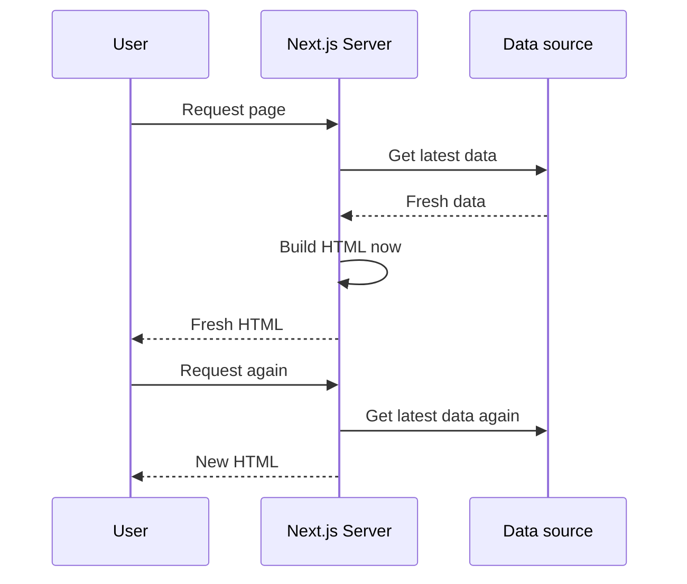

### 🧪 Example
**`app/rendering/ssr/page.js`**
```jsx
export const dynamic = 'force-dynamic';     // 👈 "render on every request"

export default function SsrPage() {
  const now = new Date().toLocaleTimeString();

  return (
    <main>
      <h1>🖥️ SSR Page</h1>
      <p>Rendered at: <b>{now}</b></p>
    </main>
  );
}
```
Refresh — **the time changes every time**.

### Other ways a page becomes SSR

| You write | Why it becomes dynamic |
|---|---|
| `export const dynamic = 'force-dynamic'` | You asked for it |
| `await cookies()` / `await headers()` | Depends on each user's request |
| `const { q } = await searchParams` | Depends on the URL query |
| `fetch(url, { cache: 'no-store' })` | You said "never cache" |

✅ **Use SSR for:** user dashboards, shopping carts, live scores, search results, anything personalised.

---

## 4. Incremental Static Regeneration (ISR)

ISR = **SSG + automatic refresh**. The page is static (fast) but is rebuilt in the background after a time limit you choose.

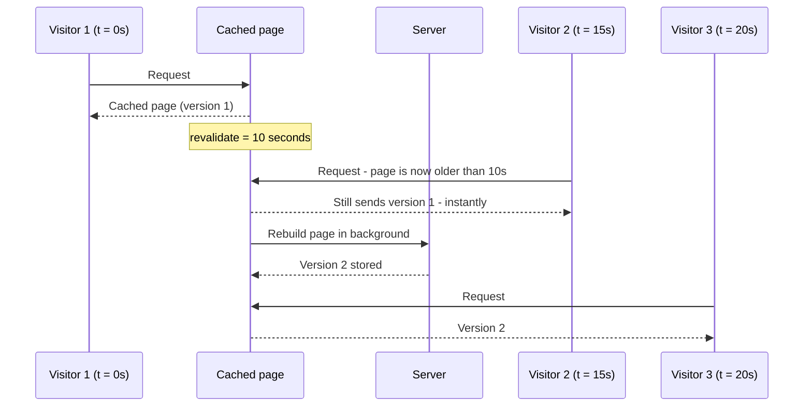

> 🧠 This is called **stale-while-revalidate**: *serve the old page right now, refresh it for the next person.* Nobody ever waits.

### 🧪 Example
**`app/rendering/isr/page.js`**
```jsx
export const revalidate = 10;               // 👈 refresh at most every 10 seconds

export default function IsrPage() {
  const builtAt = new Date().toLocaleTimeString();

  return (
    <main>
      <h1>🔁 ISR Page</h1>
      <p>This version was created at: <b>{builtAt}</b></p>
    </main>
  );
}
```
Build and start, then refresh repeatedly:
- first 10 seconds → same time
- after 10 seconds → one refresh still shows the old time (and triggers rebuild)
- next refresh → **new time** ✨

✅ **Use ISR for:** news pages, product listings, prices, blog home — content that changes sometimes.

---

## 5. Client-Side Rendering (CSR)

The server sends a nearly empty page + JavaScript. **The browser** runs the JavaScript, fetches data, and builds the UI.

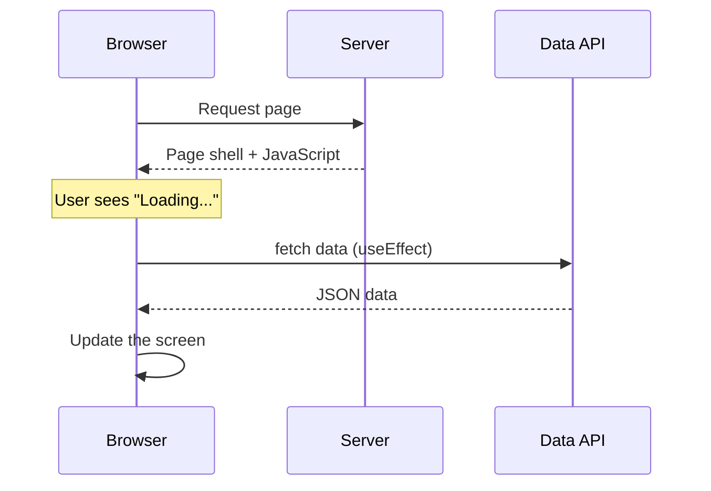

### 🧪 Example — a live clock
**`app/rendering/csr/Clock.js`**
```jsx
'use client';

import { useState, useEffect } from 'react';

export default function Clock() {
  const [time, setTime] = useState(null);

  useEffect(() => {
    setTime(new Date().toLocaleTimeString());
    const id = setInterval(() => setTime(new Date().toLocaleTimeString()), 1000);
    return () => clearInterval(id);          // cleanup
  }, []);

  return <p>Live time: <b>{time ?? 'Loading...'}</b></p>;
}
```
**`app/rendering/csr/page.js`**
```jsx
import Clock from './Clock';

export default function CsrPage() {
  return (
    <main>
      <h1>💻 CSR Page</h1>
      <Clock />
    </main>
  );
}
```
The time **ticks every second** — only the browser can do that.

✅ **Use CSR for:** things that change *after* the page loads — live clocks, chat, interactive charts, data behind a button click.
⚠️ **Avoid CSR for:** main page content that search engines must read (SEO) or that you want on screen instantly.

---

## 6. Choosing the Right Strategy

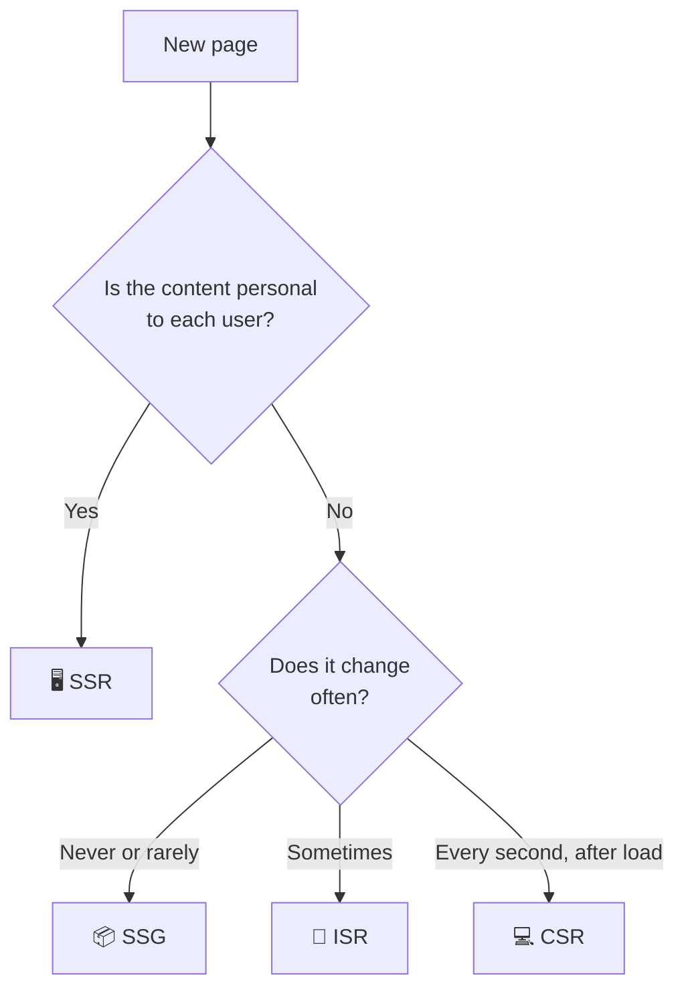

| Page | Best choice | Reason |
|---|---|---|
| About us, Terms | SSG | Never changes |
| Blog article | SSG or ISR | Changes rarely |
| Product list / prices | ISR (60–300 s) | Changes sometimes, must be fast |
| News homepage | ISR (30–60 s) | Updated often, not per user |
| User dashboard | SSR | Personal data |
| Search results | SSR | Depends on the query |
| Chat, live notifications | CSR | Real-time, after load |

### 🔀 Real pages mix strategies
A product page can be **static** for the product details and use a **Client Component** for a live "stock left" counter:
```jsx
// app/shop/[id]/page.js   (Server Component → static / ISR)
import StockCounter from './StockCounter';     // 'use client' component

export const revalidate = 60;

export default async function Product({ params }) {
  const { id } = await params;
  return (
    <main>
      <h1>Product {id}</h1>        {/* static, fast, SEO friendly */}
      <StockCounter id={id} />     {/* loaded in the browser */}
    </main>
  );
}
```

> 🆕 **Next.js 16 note — Cache Components (optional reading).**
> Next.js 16 adds a new, opt-in caching model: enable `cacheComponents: true` in `next.config`, then mark what to cache with the `"use cache"` directive. In that model everything is dynamic by default and you opt **in** to caching. These notes use the classic model above (`revalidate`, `fetch` options), which is what most projects and tutorials use today. Your instructor will tell you if you need the new model.

---

# 🌐 Data Fetching

## 7. Where Can Data Be Fetched?

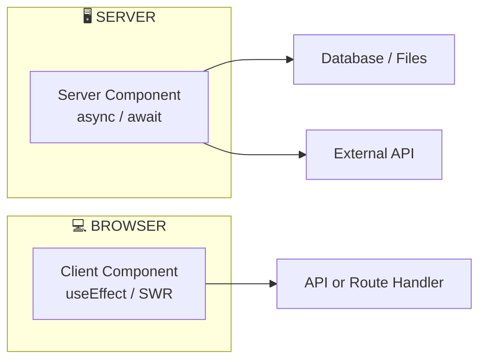

| | Server Component fetching | Client Component fetching |
|---|---|---|
| Where it runs | Server | Browser |
| Syntax | `await fetch(...)` directly | `useEffect` + `useState` (or SWR) |
| Can use secrets / database | ✅ | ❌ |
| Data is in the first HTML (SEO) | ✅ | ❌ |
| Good for | **Most data** | Data after user actions, live updates |

> 🧠 **Golden rule:** *Fetch on the server by default. Use client-side fetching only when you must.*

---

## 8. The Fetch API 📡

`fetch()` is the standard way to request data over HTTP. It works in browsers and in Node.js.

```js
const response = await fetch('https://jsonplaceholder.typicode.com/posts/1');

console.log(response.ok);        // true if status is 200-299
console.log(response.status);    // 200

const data = await response.json();   // convert body to a JavaScript object
console.log(data.title);
```

### Sending data (POST)
```js
const response = await fetch('https://jsonplaceholder.typicode.com/posts', {
  method: 'POST',
  headers: { 'Content-Type': 'application/json' },
  body: JSON.stringify({ title: 'Hello', body: 'My first post', userId: 1 }),
});
const created = await response.json();
```

### Next.js adds caching options to `fetch`

| Option | Meaning |
|---|---|
| `cache: 'force-cache'` | Store the result; reuse it |
| `cache: 'no-store'` | Never store; fetch fresh every time |
| `next: { revalidate: 60 }` | Store, but refresh after 60 seconds |
| `next: { tags: ['posts'] }` | Give the cache a name so you can clear it later |

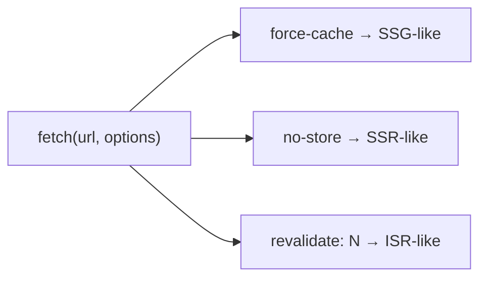

---

## 9. Server-Side Data Fetching (Server Components)

A Server Component can be **`async`**. Just `await` your data and render it. No `useEffect`, no loading state code.

### 🧪 Example — list posts from an API
**`app/posts/page.js`**
```jsx
async function getPosts() {
  const res = await fetch('https://jsonplaceholder.typicode.com/posts?_limit=5', {
    cache: 'no-store',                       // be explicit: always fresh
  });

  if (!res.ok) {
    throw new Error('Failed to fetch posts');   // error.js will catch this
  }
  return res.json();
}

export default async function PostsPage() {
  const posts = await getPosts();

  return (
    <main>
      <h1>📰 Latest Posts</h1>
      <ul>
        {posts.map((post) => (
          <li key={post.id}>{post.title}</li>
        ))}
      </ul>
    </main>
  );
}
```
```mermaid
sequenceDiagram
    participant B as Browser
    participant N as Next.js Server
    participant API as jsonplaceholder

    B->>N: GET /posts
    N->>API: fetch posts
    API-->>N: JSON
    N->>N: Render list to HTML
    N-->>B: Finished HTML - data already inside
```

### 9.1 What does a plain `fetch(url)` do?

| You write | Behaviour (production) |
|---|---|
| `fetch(url)` on a page without cookies/headers/searchParams | Fetched **once at build time** → page is static |
| `fetch(url, { cache: 'force-cache' })` | Cached; reused |
| `fetch(url, { cache: 'no-store' })` | Fresh on **every request** |
| `fetch(url, { next: { revalidate: 60 } })` | Cached, refreshed after 60 s |
| `fetch` that runs **after** `await cookies()` / `await headers()` | Fresh on every request |

> 💡 **Tip:** always write the option you mean (`no-store`, `revalidate`...). Explicit code is easier to understand and debug.

### 9.2 Fetching directly from a file or database
Server Components can skip `fetch` and read data directly:
```jsx
import { readFile } from 'node:fs/promises';
import path from 'node:path';

export default async function Page() {
  const file = await readFile(path.join(process.cwd(), 'data', 'students.json'), 'utf-8');
  const students = JSON.parse(file);

  return <ul>{students.map((s) => <li key={s.id}>{s.name}</li>)}</ul>;
}
```
This code **never reaches the browser** — so database passwords stay safe.

### 9.3 Fetch in parallel, not one-by-one ⚡

```jsx
// ❌ Slow: second request waits for the first (waterfall)
const user = await getUser();
const posts = await getPosts();

// ✅ Fast: both start together
const [user, posts] = await Promise.all([getUser(), getPosts()]);
```
```mermaid
flowchart LR
    subgraph SEQ["❌ Sequential: about 2 seconds"]
        direction LR
        S1["getUser
        1 s"] --> S2["getPosts
        1 s"]
    end
    subgraph PAR["✅ Parallel: about 1 second"]
        direction LR
        P1["getUser
        1 s"]
        P2["getPosts
        1 s"]
    end
```

### 9.4 Show the page in pieces with `<Suspense>` (streaming)
Don't make the whole page wait for the slowest part.

```jsx
import { Suspense } from 'react';

async function SlowPosts() {
  await new Promise((r) => setTimeout(r, 3000));        // pretend this is slow
  const res = await fetch('https://jsonplaceholder.typicode.com/posts?_limit=3', { cache: 'no-store' });
  const posts = await res.json();
  return <ul>{posts.map((p) => <li key={p.id}>{p.title}</li>)}</ul>;
}

export default function Page() {
  return (
    <main>
      <h1>Shows instantly ⚡</h1>
      <Suspense fallback={<p>⏳ Loading posts...</p>}>
        <SlowPosts />
      </Suspense>
    </main>
  );
}
```
The heading appears **immediately**; the list streams in after 3 seconds.

---

## 10. Client Components and Client-Side Fetching

Use this when data depends on **what the user does after the page loads** (button click, typing, live updates).

### 🧪 Example — load users on button click
**`app/users/UserLoader.js`**
```jsx
'use client';

import { useState } from 'react';

export default function UserLoader() {
  const [users, setUsers] = useState([]);
  const [loading, setLoading] = useState(false);
  const [error, setError] = useState(null);

  async function loadUsers() {
    setLoading(true);
    setError(null);
    try {
      const res = await fetch('https://jsonplaceholder.typicode.com/users?_limit=5');
      if (!res.ok) throw new Error('Request failed');
      setUsers(await res.json());
    } catch (err) {
      setError(err.message);
    } finally {
      setLoading(false);
    }
  }

  return (
    <div>
      <button onClick={loadUsers} disabled={loading}>
        {loading ? 'Loading...' : 'Load users'}
      </button>

      {error && <p style={{ color: 'red' }}>⚠️ {error}</p>}

      <ul>
        {users.map((u) => (
          <li key={u.id}>{u.name} — {u.email}</li>
        ))}
      </ul>
    </div>
  );
}
```
**`app/users/page.js`**
```jsx
import UserLoader from './UserLoader';

export default function UsersPage() {
  return (
    <main>
      <h1>👥 Users</h1>
      <UserLoader />
    </main>
  );
}
```

### The three states of every client fetch
```mermaid
flowchart LR
    A["⏳ loading"] --> B["✅ success
    show data"]
    A --> C["❌ error
    show message"]
```
> ⚠️ **Always handle all three: loading, success, error.**

### 10.1 Fetch on page load with `useEffect`
```jsx
'use client';
import { useState, useEffect } from 'react';

export default function Joke() {
  const [data, setData] = useState(null);

  useEffect(() => {
    fetch('https://jsonplaceholder.typicode.com/posts/1')
      .then((res) => res.json())
      .then(setData);
  }, []);                                   // [] = run once after first render

  if (!data) return <p>Loading...</p>;
  return <h3>{data.title}</h3>;
}
```

### 10.2 Easier with SWR (recommended library)
SWR (made by the Next.js team) handles loading, errors, caching and re-fetching for you.
```bash
npm install swr
```
```jsx
'use client';
import useSWR from 'swr';

const fetcher = (url) => fetch(url).then((res) => res.json());

export default function Profile() {
  const { data, error, isLoading } = useSWR(
    'https://jsonplaceholder.typicode.com/users/1',
    fetcher
  );

  if (error) return <p>Failed to load</p>;
  if (isLoading) return <p>Loading...</p>;
  return <h3>Hello, {data.name}</h3>;
}
```
SWR also **re-fetches when you return to the tab** — your data stays fresh automatically.

### 10.3 Server or Client fetching — decide quickly

| Question | Answer → Use |
|---|---|
| Needed to show the page first time? | Server |
| Needs a database or secret key? | Server |
| Must be good for SEO? | Server |
| Depends on a click / typing / timer? | Client |
| Needs constant live updates? | Client (SWR) |

---

## 11. Caching and Revalidation 🗄️

**Caching** = remember a result so you don't repeat slow work.
**Revalidation** = throw away old cached data and get fresh data.

### 11.1 The cache layers (simple view)

```mermaid
flowchart TD
    R["Request"] --> M["1️⃣ Request Memoization
    Same fetch twice in one render
    → runs only once"]
    M --> D["2️⃣ Data Cache
    Saved fetch results on the server
    (fetch options control it)"]
    D --> F["3️⃣ Full Route Cache
    Saved HTML of static pages"]
    F --> RC["4️⃣ Router Cache
    Pages remembered in the browser
    while navigating"]
```

| Layer | Where | Purpose |
|---|---|---|
| Request memoization | Server, one render | Same `fetch` URL used by many components → one request |
| Data cache | Server | Reuse fetch results across users |
| Full route cache | Server | Reuse built HTML of static pages |
| Router cache | Browser | Instant back/forward and prefetched pages |

### 11.2 Time-based revalidation ⏱️
```jsx
// one fetch
const res = await fetch('https://api.example.com/news', {
  next: { revalidate: 60 },          // refresh data after 60 seconds
});
```
```jsx
// whole page (every fetch on it)
export const revalidate = 60;
```
> 🧠 If a page has several revalidate values, the **smallest** one wins for the page.

### 11.3 On-demand revalidation 🎯
Refresh **immediately** when something changes (e.g. an admin edits a post) — don't wait for the timer.

**Step 1 — tag your data**
```jsx
const res = await fetch('https://jsonplaceholder.typicode.com/posts?_limit=5', {
  next: { tags: ['posts'] },          // name this cache entry "posts"
});
```
**Step 2 — clear it when data changes**
```js
import { revalidateTag, revalidatePath } from 'next/cache';

revalidateTag('posts', 'max');        // clear everything tagged "posts"
revalidatePath('/blog');              // or clear one page by its URL
```
> ⚠️ **Next.js 16:** `revalidateTag` now needs a **second argument** (`'max'` is the recommended value). The one-argument form is deprecated.

You call these inside a **Route Handler** or a **Server Action** (both explained in Unit III). Here is a tiny example:

**`app/api/revalidate/route.js`**
```js
import { revalidateTag } from 'next/cache';

export async function POST(request) {
  const { tag } = await request.json();
  revalidateTag(tag, 'max');
  return Response.json({ revalidated: true, tag });
}
```
Test: `curl -X POST http://localhost:3000/api/revalidate -H "Content-Type: application/json" -d '{"tag":"posts"}'`

```mermaid
sequenceDiagram
    participant A as Admin edits data
    participant R as revalidateTag posts
    participant C as Cache
    participant V as Next visitor

    A->>R: Data changed
    R->>C: Mark "posts" as stale
    V->>C: Request posts page
    C-->>V: Fresh data (re-fetched)
```

### 11.4 Caching things that are not `fetch` (databases)
`fetch` is cached automatically; a database call is not. Wrap it with `unstable_cache`:
```js
import { unstable_cache } from 'next/cache';
import { db } from '@/lib/db';

export const getCachedUsers = unstable_cache(
  async () => db.users.findAll(),      // slow database query
  ['all-users'],                       // cache key
  { tags: ['users'], revalidate: 3600 } // refresh hourly, or when tag "users" is cleared
);
```

### 11.5 Remove duplicate work with React `cache()`
If several components need the **same** database data in one render:
```js
import { cache } from 'react';

export const getUser = cache(async (id) => {
  console.log('querying database...');     // prints ONCE per render
  return db.users.findOne(id);
});
```

### 11.6 Cheat sheet 📋

| I want... | Write |
|---|---|
| Page built once (SSG) | no dynamic code, or `fetch(url, { cache: 'force-cache' })` |
| Always fresh (SSR) | `fetch(url, { cache: 'no-store' })` or `export const dynamic = 'force-dynamic'` |
| Refresh every N seconds (ISR) | `fetch(url, { next: { revalidate: N } })` or `export const revalidate = N` |
| Refresh when data changes | `next: { tags: [...] }` + `revalidateTag(tag, 'max')` or `revalidatePath(url)` |
| Cache a database query | `unstable_cache(fn, keys, { tags, revalidate })` |

---

## 📌 Unit II — Quick Revision

| Topic | Remember |
|---|---|
| SSG | Built once at build time — fastest |
| SSR | Built per request — `dynamic = 'force-dynamic'` or `no-store` |
| ISR | Static + refresh every N s — `revalidate = N` |
| CSR | Browser fetches after load — `'use client'` + `useEffect` / SWR |
| Server fetching | `async` component + `await fetch` — **default choice** |
| Client fetching | Only for user-driven / live data |
| Test rendering | `npm run build` + `npm start` |
| On-demand refresh | `revalidateTag(tag, 'max')` / `revalidatePath(path)` |

### ❓ Common Errors

| Symptom | Cause | Fix |
|---|---|---|
| Time never changes in production | Page is static | Add `dynamic = 'force-dynamic'` or `revalidate` |
| Time changes on every refresh in dev | Dev always renders on demand | Test with `build` + `start` |
| `useEffect` / `useState` error | Hook in Server Component | Add `'use client'` |
| Data is old after update | Cached | `revalidatePath` / `revalidateTag` |
| `revalidateTag` warning | Missing 2nd argument | `revalidateTag('tag', 'max')` |
| Fetch seems slow (waterfall) | Awaiting one by one | Use `Promise.all` |

---

# 🔌 UNIT III — API Development, Forms & Server Actions

---

# 🛠️ API Development

## 1. What is an API Route? (Route Handlers)

A **Route Handler** lets you write backend endpoints **inside your Next.js project** — no separate Express server needed.

You create a file named **`route.js`** and export a function named after the HTTP method.

```
app/
└── api/
    └── hello/
        └── route.js      → http://localhost:3000/api/hello
```

```mermaid
flowchart LR
    C["📱 Browser / App / Postman"] -->|"GET /api/hello"| R["app/api/hello/route.js
    export async function GET"]
    R -->|"JSON response"| C
```

### 🧪 Your first API
**`app/api/hello/route.js`**
```js
export async function GET() {
  return Response.json({ message: 'Hello from Next.js API! 👋' });
}
```
Open **http://localhost:3000/api/hello** → you see the JSON.

> ⚠️ A folder cannot have **both** `page.js` and `route.js` — they would fight for the same URL.

---

## 2. HTTP Methods and REST APIs

### 2.1 HTTP methods (the "verbs")

| Method | Purpose | Example | Success code |
|---|---|---|---|
| `GET` | **Read** data | Get all students | `200 OK` |
| `POST` | **Create** new data | Add a student | `201 Created` |
| `PUT` | **Replace / update** data | Update a student | `200 OK` |
| `PATCH` | Update **part** of data | Change only the name | `200 OK` |
| `DELETE` | **Remove** data | Delete a student | `200` or `204 No Content` |

### 2.2 What makes an API "REST"?
REST = organize your API around **resources** (nouns) and use **methods** as actions.

| Action | ❌ Bad URL | ✅ RESTful |
|---|---|---|
| List students | `GET /getAllStudents` | `GET /api/students` |
| One student | `GET /getStudent?id=3` | `GET /api/students/3` |
| Create | `POST /createStudent` | `POST /api/students` |
| Update | `POST /updateStudent` | `PUT /api/students/3` |
| Delete | `GET /deleteStudent?id=3` | `DELETE /api/students/3` |

### 2.3 Status codes you must know

| Code | Meaning | Use when |
|---|---|---|
| `200` | OK | Request worked |
| `201` | Created | New item created |
| `204` | No Content | Deleted, nothing to return |
| `400` | Bad Request | Invalid input from the client |
| `401` | Unauthorized | Not logged in |
| `403` | Forbidden | Logged in but not allowed |
| `404` | Not Found | Item does not exist |
| `500` | Server Error | Your code crashed |

---

## 3. Request and Response Handling

### 3.1 The pieces

```mermaid
flowchart TD
    Req["📥 request"] --> J["await request.json() → JSON body"]
    Req --> F["await request.formData() → form data"]
    Req --> Q["request.nextUrl.searchParams → ?a=1&b=2"]
    Req --> H["request.headers.get('...') → headers"]
    Res["📤 response"] --> R1["Response.json(data, { status })"]
    Res --> R2["new Response(text, { headers })"]
    Res --> R3["NextResponse.redirect(url)"]
```

### 🧪 Example — read query string, headers, and body
**`app/api/echo/route.js`**
```js
export async function GET(request) {
  const name = request.nextUrl.searchParams.get('name') ?? 'stranger';
  const agent = request.headers.get('user-agent');

  return Response.json({ greeting: `Hello, ${name}!`, yourBrowser: agent });
}

export async function POST(request) {
  let body;
  try {
    body = await request.json();                 // may throw if body is not valid JSON
  } catch {
    return Response.json({ error: 'Invalid JSON' }, { status: 400 });
  }
  return Response.json({ youSent: body }, { status: 201 });
}
```
Try: `/api/echo?name=Riya`

### 3.2 Setting headers and cookies
```js
import { NextResponse } from 'next/server';

export async function GET() {
  const res = NextResponse.json({ ok: true });
  res.headers.set('X-Powered-By', 'LPU Class');
  res.cookies.set('visited', 'yes', { httpOnly: true, maxAge: 60 * 60 });
  return res;
}
```
Reading cookies and headers in a handler:
```js
import { cookies, headers } from 'next/headers';

export async function GET() {
  const cookieStore = await cookies();                    // 👈 async in Next.js 15/16
  const headerList = await headers();
  return Response.json({
    visited: cookieStore.get('visited')?.value ?? null,
    host: headerList.get('host'),
  });
}
```

### 3.3 Caching note
`GET` handlers are **not cached by default** (they run on every request). To cache one, add `export const dynamic = 'force-static';`.

---

## 4. Dynamic Route Handlers

Just like pages, use `[param]` folders:
```
app/api/students/[id]/route.js    → /api/students/1, /api/students/42 ...
```
The second argument gives you `params` — **a Promise** (same as pages):
```js
export async function GET(request, { params }) {
  const { id } = await params;
  return Response.json({ id });
}
```

---

## 5. 🧪 Build a Complete REST API — Students CRUD

We use an **in-memory array** as a fake database (it resets when the server restarts). In Unit IV you will replace it with a real database.

```
app/api/students/
├── route.js           → GET (list), POST (create)
└── [id]/
    └── route.js       → GET (one), PUT (update), DELETE (remove)
lib/
└── students.js        → our fake database
```

**`lib/students.js`**
```js
// globalThis keeps the data alive between hot-reloads in development
const g = globalThis;
g.__students ??= [
  { id: 1, name: 'Riya', cgpa: 8.9 },
  { id: 2, name: 'Aman', cgpa: 8.1 },
];

export const students = g.__students;

export function nextStudentId() {
  return Math.max(0, ...students.map((s) => s.id)) + 1;
}
```

**`app/api/students/route.js`**
```js
import { students, nextStudentId } from '@/lib/students';

// GET /api/students            → all students
// GET /api/students?minCgpa=8.5 → filter
export async function GET(request) {
  const min = Number(request.nextUrl.searchParams.get('minCgpa') ?? 0);
  const result = students.filter((s) => s.cgpa >= min);
  return Response.json(result);
}

// POST /api/students           → create
export async function POST(request) {
  let body;
  try {
    body = await request.json();
  } catch {
    return Response.json({ error: 'Invalid JSON' }, { status: 400 });
  }

  const { name, cgpa } = body;
  if (!name || typeof cgpa !== 'number') {
    return Response.json(
      { error: 'name (string) and cgpa (number) are required' },
      { status: 400 }
    );
  }

  const student = { id: nextStudentId(), name, cgpa };
  students.push(student);
  return Response.json(student, { status: 201 });
}
```

**`app/api/students/[id]/route.js`**
```js
import { students } from '@/lib/students';

function findIndex(id) {
  return students.findIndex((s) => s.id === Number(id));
}

// GET /api/students/1
export async function GET(request, { params }) {
  const { id } = await params;
  const student = students[findIndex(id)];
  if (!student) return Response.json({ error: 'Student not found' }, { status: 404 });
  return Response.json(student);
}

// PUT /api/students/1
export async function PUT(request, { params }) {
  const { id } = await params;
  const index = findIndex(id);
  if (index === -1) return Response.json({ error: 'Student not found' }, { status: 404 });

  const body = await request.json();
  students[index] = { ...students[index], ...body, id: students[index].id };
  return Response.json(students[index]);
}

// DELETE /api/students/1
export async function DELETE(request, { params }) {
  const { id } = await params;
  const index = findIndex(id);
  if (index === -1) return Response.json({ error: 'Student not found' }, { status: 404 });

  students.splice(index, 1);
  return new Response(null, { status: 204 });          // 204 = success, no body
}
```

### 🧪 Test your API
Use **Thunder Client** (VS Code), **Postman**, or `curl`:
```bash
# read all
curl http://localhost:3000/api/students

# create
curl -X POST http://localhost:3000/api/students \
  -H "Content-Type: application/json" \
  -d '{"name":"Simran","cgpa":9.3}'

# update
curl -X PUT http://localhost:3000/api/students/1 \
  -H "Content-Type: application/json" \
  -d '{"cgpa":9.5}'

# delete
curl -X DELETE http://localhost:3000/api/students/2
```
> 💡 On Windows PowerShell write `curl.exe` (plain `curl` is a different command), or just use Thunder Client.

| Request | Expected result |
|---|---|
| `GET /api/students` | `200` + array |
| `POST` with valid body | `201` + new student |
| `POST` without `name` | `400` + error |
| `GET /api/students/99` | `404` |
| `DELETE /api/students/2` | `204` |

### 5.1 Use your own API from a page
```jsx
// app/students/page.js  (Server Component)
import { students } from '@/lib/students';

export const dynamic = 'force-dynamic';

export default function StudentsPage() {
  return (
    <ul>
      {students.map((s) => <li key={s.id}>{s.name} — CGPA {s.cgpa}</li>)}
    </ul>
  );
}
```
> 🧠 **Tip:** inside a Server Component, read the data **directly** (as above) — don't call your own API with `fetch`. Route Handlers are for **outside** clients (mobile apps, other websites) and for Client Components.

### 5.2 Route Handler or Server Action?

| | Route Handler | Server Action |
|---|---|---|
| Looks like | URL endpoint (`/api/...`) | A function you call |
| Used by | Mobile apps, other sites, Client Components, webhooks | Your own forms and buttons |
| Methods | GET, POST, PUT, DELETE... | POST only (automatic) |
| Best for | Public / external API | Form submit, data changes in your UI |

---

# 📝 Forms and Server Actions

## 6. Server Actions

A **Server Action** is an `async` function that **runs on the server** but you call it **like a normal function from a form or button**. No API route, no `fetch`.

```mermaid
sequenceDiagram
    participant U as User
    participant F as Form in browser
    participant A as Server Action on server
    participant D as Data

    U->>F: Fill form and click Submit
    F->>A: Automatically sends form data
    A->>D: Save data
    A-->>F: Returns result
    F-->>U: Screen updates
```

You mark them with the **`'use server'`** directive.

### 🧪 Example 1 — action inside a Server Component
**`app/greet/page.js`**
```jsx
export default function GreetPage() {
  async function greet(formData) {
    'use server';                                  // 👈 this function runs on the server
    const name = formData.get('name');
    console.log('Hello,', name);                   // shows in the TERMINAL
  }

  return (
    <form action={greet}>
      <input name="name" placeholder="Your name" />
      <button type="submit">Greet</button>
    </form>
  );
}
```
Submit the form and watch the terminal. No `onSubmit`, no `fetch`, no API.

### 🧪 Example 2 — actions in a separate file (recommended)
**`app/todos/actions.js`**
```js
'use server';                                      // 👈 at the top: ALL exports are server actions

export async function sayHello(formData) {
  const name = formData.get('name');
  console.log(`Hello ${name}`);
}
```
Separate files can be imported by **both** Server and Client Components.

### 6.1 Important rules

| Rule | Why |
|---|---|
| Form inputs need a **`name`** attribute | `formData.get('name')` reads by name |
| Action receives **`FormData`** as its argument | Standard web API |
| Server Actions are **public endpoints** | Anyone can send a POST — always **validate input** and **check login** |
| Return only simple data (objects, strings, numbers) | It is sent over the network |

> ⚠️ **Security:** never think "only my form calls this". Validate every input and check permissions **inside every action** (Unit IV shows how).

---

## 7. Form Handling

### 7.1 The standard flow
```mermaid
flowchart LR
    A["1. HTML form
    with name attributes"] --> B["2. action={serverAction}"]
    B --> C["3. Action validates
    and saves"]
    C --> D["4. revalidatePath
    or redirect"]
    D --> E["5. UI shows new data"]
```

### 7.2 Pending state with `useFormStatus`
Disable the button while the form is submitting (prevents double clicks). The hook must be used in a **component placed inside the form**.

**`app/components/SubmitButton.js`**
```jsx
'use client';

import { useFormStatus } from 'react-dom';

export default function SubmitButton({ children }) {
  const { pending } = useFormStatus();

  return (
    <button type="submit" disabled={pending}>
      {pending ? '⏳ Saving...' : children}
    </button>
  );
}
```

### 7.3 Showing results with `useActionState`
`useActionState` connects a form to an action **and** gives you the action's return value (messages, errors).

```jsx
const [state, formAction, pending] = useActionState(action, initialState);
```
| Part | Meaning |
|---|---|
| `state` | Whatever the action last returned |
| `formAction` | Pass this to `<form action={...}>` |
| `pending` | `true` while submitting |
| `action(prevState, formData)` | Your server action — **first argument is the previous state** |

### 🧪 Example — feedback form with a success message
**`app/feedback/actions.js`**
```js
'use server';

export async function sendFeedback(prevState, formData) {
  const message = formData.get('message')?.toString().trim();

  if (!message) {
    return { ok: false, text: 'Please write something.' };
  }

  console.log('Feedback received:', message);       // later: save to a database
  return { ok: true, text: 'Thank you for your feedback! 🎉' };
}
```
**`app/feedback/FeedbackForm.js`**
```jsx
'use client';

import { useActionState } from 'react';
import { sendFeedback } from './actions';

export default function FeedbackForm() {
  const [state, formAction, pending] = useActionState(sendFeedback, null);

  return (
    <form action={formAction}>
      <textarea name="message" rows={4} placeholder="Your feedback" />
      <br />
      <button type="submit" disabled={pending}>
        {pending ? 'Sending...' : 'Send'}
      </button>
      {state && <p style={{ color: state.ok ? 'green' : 'red' }}>{state.text}</p>}
    </form>
  );
}
```
**`app/feedback/page.js`**
```jsx
import FeedbackForm from './FeedbackForm';

export default function FeedbackPage() {
  return (
    <main>
      <h1>💬 Feedback</h1>
      <FeedbackForm />
    </main>
  );
}
```

---

## 8. Form Validation

Validate in **two places**:

```mermaid
flowchart LR
    A["1️⃣ Browser
    HTML attributes
    quick feedback"] --> B["2️⃣ Server
    Zod schema
    the REAL protection"]
```

> 🧠 **Never trust the browser.** Anyone can skip your HTML and send data directly. Server validation is **mandatory**.

### 8.1 Level 1 — HTML validation (free)
```html
<input name="email" type="email" required />
<input name="age" type="number" min="16" max="60" required />
<input name="name" minLength="2" required />
```

### 8.2 Level 2 — Server validation with Zod
**Zod** is a popular library to describe and check data shapes.
```bash
npm install zod
```
```js
import { z } from 'zod';

const schema = z.object({
  name: z.string().min(2, 'Name must be at least 2 characters'),
  email: z.email('Enter a valid email'),
  age: z.coerce.number().int().min(16, 'Minimum age is 16').max(60, 'Maximum age is 60'),
});

const result = schema.safeParse({ name: 'R', email: 'bad', age: '12' });

result.success;        // false
result.error.issues;   // list of problems: [{ path: ['name'], message: '...' }, ...]
result.data;           // cleaned data (only when success is true)
```
> 💡 `z.coerce.number()` converts the string `"21"` (all form values are strings!) into the number `21`.

A small helper to turn Zod issues into `{ field: [messages] }`:

**`lib/validation.js`**
```js
export function fieldErrors(error) {
  const errors = {};
  for (const issue of error.issues) {
    const field = issue.path[0];
    (errors[field] ??= []).push(issue.message);
  }
  return errors;
}
```

### 🧪 Complete example — Registration form with validation
**`app/register/actions.js`**
```js
'use server';

import { z } from 'zod';
import { fieldErrors } from '@/lib/validation';

const RegisterSchema = z.object({
  name: z.string().min(2, 'Name must be at least 2 characters'),
  email: z.email('Enter a valid email'),
  age: z.coerce.number().int().min(16, 'Minimum age is 16').max(60, 'Maximum age is 60'),
});

export async function register(prevState, formData) {
  const values = Object.fromEntries(formData);          // { name, email, age }
  const parsed = RegisterSchema.safeParse(values);

  if (!parsed.success) {
    return { errors: fieldErrors(parsed.error), values, message: null };
  }

  console.log('New student:', parsed.data);             // later: save in a database
  return { errors: {}, values: {}, message: `Welcome, ${parsed.data.name}! ✅` };
}
```

**`app/register/RegisterForm.js`**
```jsx
'use client';

import { useActionState } from 'react';
import { register } from './actions';
import SubmitButton from '../components/SubmitButton';

const initialState = { errors: {}, values: {}, message: null };

export default function RegisterForm() {
  const [state, formAction] = useActionState(register, initialState);

  return (
    <form action={formAction} style={{ display: 'grid', gap: 12, maxWidth: 320 }}>
      <label>
        Name
        <input name="name" defaultValue={state.values?.name} />
        {state.errors?.name && <small style={{ color: 'red' }}>{state.errors.name[0]}</small>}
      </label>

      <label>
        Email
        <input name="email" defaultValue={state.values?.email} />
        {state.errors?.email && <small style={{ color: 'red' }}>{state.errors.email[0]}</small>}
      </label>

      <label>
        Age
        <input name="age" defaultValue={state.values?.age} />
        {state.errors?.age && <small style={{ color: 'red' }}>{state.errors.age[0]}</small>}
      </label>

      <SubmitButton>Register</SubmitButton>

      {state.message && <p style={{ color: 'green' }}>{state.message}</p>}
    </form>
  );
}
```

**`app/register/page.js`**
```jsx
import RegisterForm from './RegisterForm';

export default function RegisterPage() {
  return (
    <main>
      <h1>🎓 Register</h1>
      <RegisterForm />
    </main>
  );
}
```
🧪 Submit with empty / wrong values and watch each field show its own error. `defaultValue={state.values?.name}` keeps what the user typed.

---

## 9. File Upload 📎

Uploading is just a form with `<input type="file">`. Server Actions receive the file inside `FormData` as a standard **`File`** object.

```mermaid
flowchart LR
    A["User picks image"] --> B["Form submit
    action={uploadAvatar}"]
    B --> C["Server: check type and size"]
    C -->|"❌ invalid"| D["Return error message"]
    C -->|"✅ valid"| E["Save file in uploads/"]
    E --> F["Show the image"]
```

### 🧪 Example — upload a profile picture

**Folder plan**
```
app/upload/
├── page.js
├── UploadForm.js
└── actions.js
app/api/files/[name]/route.js     ← serves uploaded files
uploads/                          ← created automatically (add to .gitignore)
```

**`app/upload/actions.js`**
```js
'use server';

import { mkdir, writeFile } from 'node:fs/promises';
import path from 'node:path';

const ALLOWED = { 'image/png': '.png', 'image/jpeg': '.jpg', 'image/webp': '.webp' };
const MAX_SIZE = 500 * 1024;                              // 500 KB

export async function uploadAvatar(prevState, formData) {
  const file = formData.get('avatar');

  if (!(file instanceof File) || file.size === 0) {
    return { error: 'Please choose a file.' };
  }
  if (!ALLOWED[file.type]) {
    return { error: 'Only PNG, JPG or WEBP images are allowed.' };
  }
  if (file.size > MAX_SIZE) {
    return { error: 'File must be 500 KB or smaller.' };
  }

  const bytes = Buffer.from(await file.arrayBuffer());
  const filename = `${Date.now()}${ALLOWED[file.type]}`;  // 👈 make our own name, never trust file.name

  const dir = path.join(process.cwd(), 'uploads');
  await mkdir(dir, { recursive: true });
  await writeFile(path.join(dir, filename), bytes);

  return { success: true, filename };
}
```

**`app/upload/UploadForm.js`**
```jsx
'use client';

import { useActionState } from 'react';
import { uploadAvatar } from './actions';

export default function UploadForm() {
  const [state, formAction, pending] = useActionState(uploadAvatar, null);

  return (
    <form action={formAction}>
      <input type="file" name="avatar" accept="image/png,image/jpeg,image/webp" />
      <button type="submit" disabled={pending}>
        {pending ? 'Uploading...' : 'Upload'}
      </button>

      {state?.error && <p style={{ color: 'red' }}>{state.error}</p>}

      {state?.success && (
        <div>
          <p style={{ color: 'green' }}>Uploaded ✅</p>
          
        </div>
      )}
    </form>
  );
}
```

**`app/upload/page.js`**
```jsx
import UploadForm from './UploadForm';

export default function UploadPage() {
  return (
    <main>
      <h1>🖼️ Upload Avatar</h1>
      <UploadForm />
    </main>
  );
}
```

**`app/api/files/[name]/route.js`** *(serves the saved file)*
```js
import { readFile } from 'node:fs/promises';
import path from 'node:path';

const TYPES = { '.png': 'image/png', '.jpg': 'image/jpeg', '.webp': 'image/webp' };

export async function GET(request, { params }) {
  const { name } = await params;
  const safeName = path.basename(name);                   // 👈 blocks "../../secret" tricks
  const type = TYPES[path.extname(safeName)];

  if (!type) return new Response('Not found', { status: 404 });

  try {
    const bytes = await readFile(path.join(process.cwd(), 'uploads', safeName));
    return new Response(bytes, { headers: { 'Content-Type': type } });
  } catch {
    return new Response('Not found', { status: 404 });
  }
}
```

### 9.1 File upload safety checklist ✅

| Check | Why |
|---|---|
| Limit **file size** | Stops huge uploads |
| Allow only needed **types** | Blocks scripts and executables |
| Create your **own filename** | `file.name` can contain `../` tricks |
| Save outside `public/` or use a storage service | Files added to `public/` after build are **not served** in production |
| Require **login** for uploads | Prevents abuse (Unit IV) |

> ⚠️ **Size limit:** Server Actions accept request bodies up to **1 MB** by default. For bigger files you can raise `serverActions.bodySizeLimit` in `next.config` (check the Next.js docs for the exact place in your version), but real apps usually upload large files straight to a storage service (Cloudinary, AWS S3, UploadThing...).
> 💡 Add `uploads/` to your `.gitignore`.

---

## 10. Data Mutations

A **mutation** is any action that **changes data**: create, update, delete. The recipe is always the same:

```mermaid
flowchart LR
    A["Form or button"] --> B["Server Action
    changes the data"]
    B --> C["revalidatePath('/page')
    tell Next.js data changed"]
    C --> D["Page re-renders
    with fresh data"]
```

### 🧪 Complete example — Todo app (Create, Update, Delete)

**`lib/todos.js`** *(fake database — replaced by a real one in Unit IV)*
```js
const g = globalThis;
g.__todos ??= [
  { id: 1, title: 'Learn Server Actions', done: false },
  { id: 2, title: 'Build a Todo app', done: false },
];

export const todos = g.__todos;

export function nextTodoId() {
  return Math.max(0, ...todos.map((t) => t.id)) + 1;
}
```

**`app/todos/actions.js`**
```js
'use server';

import { revalidatePath } from 'next/cache';
import { todos, nextTodoId } from '@/lib/todos';

export async function addTodo(formData) {
  const title = formData.get('title')?.toString().trim();
  if (!title) return;                                      // ignore empty input

  todos.push({ id: nextTodoId(), title, done: false });
  revalidatePath('/todos');
}

export async function toggleTodo(id) {
  const todo = todos.find((t) => t.id === id);
  if (todo) todo.done = !todo.done;
  revalidatePath('/todos');
}

export async function deleteTodo(id) {
  const index = todos.findIndex((t) => t.id === id);
  if (index !== -1) todos.splice(index, 1);
  revalidatePath('/todos');
}
```

**`app/todos/page.js`**
```jsx
import { todos } from '@/lib/todos';
import { addTodo, toggleTodo, deleteTodo } from './actions';

export const dynamic = 'force-dynamic';                    // data changes → render on every request

export default function TodosPage() {
  return (
    <main>
      <h1>✅ Todos</h1>

      <form action={addTodo}>
        <input name="title" placeholder="New task" required />
        <button type="submit">Add</button>
      </form>

      <ul>
        {todos.map((todo) => (
          <li key={todo.id}>
            {/* .bind(null, id) pre-fills the first argument of the action */}
            <form action={toggleTodo.bind(null, todo.id)} style={{ display: 'inline' }}>
              <button>{todo.done ? '☑️' : '⬜'}</button>
            </form>

            <span style={{ textDecoration: todo.done ? 'line-through' : 'none' }}>
              {' '}{todo.title}{' '}
            </span>

            <form action={deleteTodo.bind(null, todo.id)} style={{ display: 'inline' }}>
              <button>🗑️</button>
            </form>
          </li>
        ))}
      </ul>
    </main>
  );
}
```
This whole app has **no `useState`, no `useEffect`, no `fetch`, no API route**.

### 10.1 Ways to refresh the screen after a mutation

| Function | Effect | Use when |
|---|---|---|
| `revalidatePath('/todos')` | Refresh one page | Most common |
| `revalidateTag('tag', 'max')` | Refresh everything tagged | Data used on many pages |
| `updateTag('tag')` *(Server Actions only)* | Refresh a tag **immediately**, so the user sees their own change at once | Forms and settings |
| `redirect('/todos')` | Send user to another page | After creating something |

```js
import { redirect } from 'next/navigation';
// ...
revalidatePath('/todos');
redirect('/todos');          // ⚠️ call redirect() LAST and never inside try/catch
```
> ⚠️ `redirect()` works by throwing a special error. If you put it inside `try { }`, your `catch` will swallow it and the redirect will not happen.

---

## 11. Optimistic UI Updates ⚡

**Optimistic UI** = update the screen **immediately**, assuming the server will succeed, instead of waiting for the server. If it fails, the screen goes back.

```mermaid
sequenceDiagram
    participant U as User
    participant UI as Screen
    participant S as Server

    U->>UI: Clicks Add
    UI->>UI: Show new item at once (grey, pending)
    UI->>S: Send request in background
    S-->>UI: Success - real data arrives
    UI->>UI: Replace temporary item with real one
    Note over UI,S: If the server fails, the temporary item disappears
```

| Without optimistic UI | With optimistic UI |
|---|---|
| Click → wait 1–2 s → item appears | Click → item appears **instantly** |
| Feels slow | Feels instant |

React gives us the **`useOptimistic`** hook:
```jsx
const [optimisticItems, addOptimistic] = useOptimistic(realItems, updateFunction);
```

### 🧪 Example — optimistic Todo list
Replace the list in the Todo app with this Client Component.

**`app/todos/TodoList.js`**
```jsx
'use client';

import { useOptimistic, startTransition } from 'react';
import { addTodo, toggleTodo } from './actions';

export default function TodoList({ todos }) {
  const [optimisticTodos, updateOptimistic] = useOptimistic(
    todos,                                         // the real list from the server
    (current, action) => {                         // how to show a "pretend" change
      if (action.type === 'add') {
        return [...current, { id: `temp-${Date.now()}`, title: action.title, done: false, sending: true }];
      }
      if (action.type === 'toggle') {
        return current.map((t) => (t.id === action.id ? { ...t, done: !t.done } : t));
      }
      return current;
    }
  );

  async function handleAdd(formData) {
    const title = formData.get('title')?.toString().trim();
    if (!title) return;
    updateOptimistic({ type: 'add', title });      // 1. update screen NOW
    await addTodo(formData);                       // 2. then tell the server
  }

  function handleToggle(id) {
    startTransition(async () => {
      updateOptimistic({ type: 'toggle', id });    // 1. flip the checkbox NOW
      await toggleTodo(id);                        // 2. then tell the server
    });
  }

  return (
    <>
      <form action={handleAdd}>
        <input name="title" placeholder="New task" required />
        <button type="submit">Add</button>
      </form>

      <ul>
        {optimisticTodos.map((todo) => (
          <li key={todo.id} style={{ opacity: todo.sending ? 0.5 : 1 }}>
            <button onClick={() => handleToggle(todo.id)}>{todo.done ? '☑️' : '⬜'}</button>
            {' '}{todo.title} {todo.sending && <em>(saving...)</em>}
          </li>
        ))}
      </ul>
    </>
  );
}
```
Use it from the page:
```jsx
// app/todos/page.js
import { todos } from '@/lib/todos';
import TodoList from './TodoList';

export const dynamic = 'force-dynamic';

export default function TodosPage() {
  return (
    <main>
      <h1>✅ Todos</h1>
      <TodoList todos={[...todos]} />        {/* plain copy → safe to send to client */}
    </main>
  );
}
```
🧪 **To see the effect clearly**, slow the server down: add this line at the top of `addTodo` and `toggleTodo`:
```js
await new Promise((resolve) => setTimeout(resolve, 1500));
```
The new item appears **instantly (faded)**, then becomes solid after 1.5 seconds.

---

## 📌 Unit III — Quick Revision

| Topic | Remember |
|---|---|
| Route Handler | `app/.../route.js`, export `GET`, `POST`, `PUT`, `DELETE` |
| Response | `Response.json(data, { status: 201 })` |
| Dynamic handler | `{ params }` is a Promise → `await params` |
| REST | Nouns in URLs, verbs as methods, correct status codes |
| Server Action | `'use server'` + `async function (formData)` |
| Form hooks | `useFormStatus` (button), `useActionState` (messages/errors) |
| Validation | HTML for comfort, **Zod on the server** for safety |
| File upload | `formData.get('file')`, check type + size, own filename |
| Mutation recipe | action → change data → `revalidatePath` / `redirect` |
| Optimistic UI | `useOptimistic` → show change first, confirm later |

### ❓ Common Errors

| Symptom | Cause | Fix |
|---|---|---|
| `formData.get('x')` is `null` | Input has no `name` | Add `name="x"` |
| Hook error in a form file | Missing `'use client'` | Add it (forms using hooks are Client Components) |
| Redirect does nothing | `redirect()` inside `try/catch` | Move it outside |
| Body exceeded 1 MB | Upload too big for Server Actions | Smaller file or raise limit |
| 404 on `/api/...` | File not named `route.js` | Rename |
| `useOptimistic` warning | Updated outside a transition/action | Use form `action` or wrap with `startTransition` |
| List does not refresh | Forgot `revalidatePath` | Call it after changing data |

---

# 🔐 UNIT IV — Authentication, Authorization & Database Integration

---

# 🔑 Authentication and Authorization

## 1. Authentication Concepts

| Term | Question it answers | Example |
|---|---|---|
| **Authentication (AuthN)** | **Who are you?** | Login with email + password |
| **Authorization (AuthZ)** | **What are you allowed to do?** | Only admins can delete users |

> 🧠 **Airport analogy:** showing your passport at the gate = *authentication*. Your boarding pass deciding which plane you can enter = *authorization*.

```mermaid
flowchart LR
    V["👤 Visitor"] --> A{"Authentication
    Who are you?"}
    A -->|"Unknown"| L["Login / Sign up page"]
    A -->|"Known user"| Z{"Authorization
    Allowed here?"}
    Z -->|"No"| X["⛔ 403 Forbidden"]
    Z -->|"Yes"| P["✅ Show the page"]
```

### 1.1 The login flow

```mermaid
sequenceDiagram
    participant U as User
    participant S as Next.js Server
    participant D as User data

    U->>S: Email + password
    S->>D: Find user by email
    D-->>S: User with password hash
    S->>S: Compare password with hash
    S->>S: Create session and put it in a cookie
    S-->>U: Redirect to dashboard + Set-Cookie
    U->>S: Later requests carry the cookie
    S->>S: Read cookie - who is this?
    S-->>U: Personalised page
```

### 1.2 Golden rules of login security 🛡️

| Rule | Why |
|---|---|
| **Never store passwords as plain text** | A leak would expose every user. Store a **hash** |
| Use **bcrypt** to hash | Slow and salted on purpose, so hard to crack |
| Use the **same error** for wrong email and wrong password | Don't reveal which emails exist |
| Store the session in an **`httpOnly`** cookie | JavaScript in the page cannot steal it |
| Keep secrets in **`.env.local`**, never in code | Code goes to GitHub |
| Check login **on the server** | Browser checks can be bypassed |

### 1.3 What is hashing? 🔒
```js
import bcrypt from 'bcryptjs';

const hash = await bcrypt.hash('myPassword123', 10);
// "$2b$10$N9qo8uLOickgx2ZMRZoMye..."   ← cannot be reversed to the password

await bcrypt.compare('myPassword123', hash);   // true
await bcrypt.compare('wrongPassword', hash);   // false
```
`10` = how much work the hash takes (higher = slower = safer).

---

## 2. Session Management

After login the server must **remember** the user across requests. We store a small **session** inside a cookie.

### 2.1 Two ways to keep a session

| | **Stateless session (JWT in cookie)** | **Database session** |
|---|---|---|
| Where is the data? | Inside the cookie (signed + tamper-proof) | In a database; cookie holds only an ID |
| Server lookup per request | ❌ not needed | ✅ yes |
| Easy to start | ✅ very | more setup |
| Log out one user remotely | harder | easy |
| Used here | ✅ | — |

We will use a **stateless session**: a **JWT** (JSON Web Token) signed with a secret key, stored in an `httpOnly` cookie.

```mermaid
flowchart LR
    P["Payload
    userId + role + expiry"] --> J["Sign with SECRET
    using jose"]
    J --> T["🎟️ JWT token string"]
    T --> C["🍪 httpOnly cookie named session"]
    C -->|"sent with every request"| V["Server verifies
    signature and expiry"]
```

### 2.2 Setup

```bash
npm install bcryptjs jose zod server-only
```
| Package | Job |
|---|---|
| `bcryptjs` | Hash and compare passwords |
| `jose` | Create and verify JWTs |
| `zod` | Validate form input |
| `server-only` | Makes the build **fail** if server code is imported into a Client Component |

**Create a secret** — run this once and copy the output:
```bash
node -e "console.log(require('crypto').randomBytes(32).toString('base64'))"
```
**`.env.local`** *(never commit this file)*
```
SESSION_SECRET=paste_the_long_random_text_here
```
Restart `npm run dev` after editing env files.

### 2.3 Step 1 — A simple user store (temporary)
We start with an in-memory list. In section 8 we swap it for a real database **without changing the rest of the code**.

**`lib/users.js`**
```js
import bcrypt from 'bcryptjs';

const g = globalThis;
g.__users ??= [
  {
    id: '1',
    name: 'Admin',
    email: 'admin@lpu.in',
    passwordHash: bcrypt.hashSync('admin12345', 10),
    role: 'admin',
  },
];
export const users = g.__users;

export async function findUserByEmail(email) {
  return users.find((u) => u.email === email) ?? null;
}

export async function findUserById(id) {
  return users.find((u) => u.id === id) ?? null;
}

export async function createUser({ name, email, passwordHash }) {
  const user = { id: String(users.length + 1), name, email, passwordHash, role: 'user' };
  users.push(user);
  return user;
}
```

### 2.4 Step 2 — Create and read the token

**`lib/jwt.js`**
```js
import { SignJWT, jwtVerify } from 'jose';

const key = new TextEncoder().encode(process.env.SESSION_SECRET);

export async function encrypt(payload) {
  return new SignJWT(payload)
    .setProtectedHeader({ alg: 'HS256' })
    .setIssuedAt()
    .setExpirationTime('7d')                   // token valid for 7 days
    .sign(key);
}

export async function decrypt(token) {
  try {
    const { payload } = await jwtVerify(token, key, { algorithms: ['HS256'] });
    return payload;                            // { userId, role, iat, exp }
  } catch {
    return null;                               // missing, expired or tampered token
  }
}
```

### 2.5 Step 3 — Save the session in a cookie

**`lib/session.js`**
```js
import 'server-only';
import { cookies } from 'next/headers';
import { encrypt } from './jwt';

const SEVEN_DAYS = 7 * 24 * 60 * 60 * 1000;

export async function createSession(userId, role) {
  const expires = new Date(Date.now() + SEVEN_DAYS);
  const token = await encrypt({ userId, role });

  const cookieStore = await cookies();
  cookieStore.set('session', token, {
    httpOnly: true,                                    // JS cannot read it
    secure: process.env.NODE_ENV === 'production',     // HTTPS only in production
    sameSite: 'lax',                                   // basic CSRF protection
    expires,
    path: '/',
  });
}

export async function deleteSession() {
  const cookieStore = await cookies();
  cookieStore.delete('session');
}
```

### 2.6 Step 4 — Sign up, log in, log out (Server Actions)

**`app/actions/auth.js`**
```js
'use server';

import bcrypt from 'bcryptjs';
import { z } from 'zod';
import { redirect } from 'next/navigation';
import { fieldErrors } from '@/lib/validation';          // helper from Unit III
import { findUserByEmail, createUser } from '@/lib/users';
import { createSession, deleteSession } from '@/lib/session';

const SignupSchema = z.object({
  name: z.string().min(2, 'Name must be at least 2 characters'),
  email: z.email('Enter a valid email'),
  password: z.string().min(8, 'Password must be at least 8 characters'),
});

const LoginSchema = z.object({
  email: z.email('Enter a valid email'),
  password: z.string().min(1, 'Password is required'),
});

export async function signup(prevState, formData) {
  const parsed = SignupSchema.safeParse(Object.fromEntries(formData));
  if (!parsed.success) return { errors: fieldErrors(parsed.error) };

  const { name, email, password } = parsed.data;

  if (await findUserByEmail(email)) {
    return { errors: { email: ['This email is already registered'] } };
  }

  const passwordHash = await bcrypt.hash(password, 10);
  const user = await createUser({ name, email, passwordHash });

  await createSession(user.id, user.role);
  redirect('/dashboard');
}

export async function login(prevState, formData) {
  const parsed = LoginSchema.safeParse(Object.fromEntries(formData));
  if (!parsed.success) return { errors: fieldErrors(parsed.error) };

  const { email, password } = parsed.data;
  const user = await findUserByEmail(email);

  // same message for "no such user" and "wrong password"
  const valid = user && (await bcrypt.compare(password, user.passwordHash));
  if (!valid) return { message: 'Invalid email or password' };

  await createSession(user.id, user.role);
  redirect('/dashboard');
}

export async function logout() {
  await deleteSession();
  redirect('/login');
}
```

### 2.7 Step 5 — The forms

**`app/login/LoginForm.js`**
```jsx
'use client';

import { useActionState } from 'react';
import { login } from '../actions/auth';

export default function LoginForm() {
  const [state, formAction, pending] = useActionState(login, undefined);

  return (
    <form action={formAction} style={{ display: 'grid', gap: 12, maxWidth: 320 }}>
      <label>
        Email
        <input name="email" type="email" />
        {state?.errors?.email && <small style={{ color: 'red' }}>{state.errors.email[0]}</small>}
      </label>

      <label>
        Password
        <input name="password" type="password" />
        {state?.errors?.password && <small style={{ color: 'red' }}>{state.errors.password[0]}</small>}
      </label>

      {state?.message && <p style={{ color: 'red' }}>{state.message}</p>}

      <button type="submit" disabled={pending}>{pending ? 'Logging in...' : 'Log in'}</button>
    </form>
  );
}
```
**`app/login/page.js`**
```jsx
import Link from 'next/link';
import LoginForm from './LoginForm';

export default function LoginPage() {
  return (
    <main>
      <h1>🔐 Log in</h1>
      <LoginForm />
      <p>New here? <Link href="/signup">Create an account</Link></p>
    </main>
  );
}
```

**`app/signup/SignupForm.js`**
```jsx
'use client';

import { useActionState } from 'react';
import { signup } from '../actions/auth';

export default function SignupForm() {
  const [state, formAction, pending] = useActionState(signup, undefined);

  return (
    <form action={formAction} style={{ display: 'grid', gap: 12, maxWidth: 320 }}>
      <label>
        Name
        <input name="name" />
        {state?.errors?.name && <small style={{ color: 'red' }}>{state.errors.name[0]}</small>}
      </label>

      <label>
        Email
        <input name="email" type="email" />
        {state?.errors?.email && <small style={{ color: 'red' }}>{state.errors.email[0]}</small>}
      </label>

      <label>
        Password
        <input name="password" type="password" />
        {state?.errors?.password && <small style={{ color: 'red' }}>{state.errors.password[0]}</small>}
      </label>

      <button type="submit" disabled={pending}>{pending ? 'Creating...' : 'Sign up'}</button>
    </form>
  );
}
```
**`app/signup/page.js`**
```jsx
import SignupForm from './SignupForm';

export default function SignupPage() {
  return (
    <main>
      <h1>📝 Sign up</h1>
      <SignupForm />
    </main>
  );
}
```

---

## 3. Protected Routes 🚧

A **protected route** is a page that only logged-in users can open. Use **two layers**:

```mermaid
flowchart TD
    R["Request /dashboard"] --> L1{"Layer 1 - proxy.js
    quick cookie check"}
    L1 -->|"No valid cookie"| LG["↩️ Redirect to /login"]
    L1 -->|"Cookie looks OK"| L2{"Layer 2 - page code
    verifySession in data layer"}
    L2 -->|"Invalid"| LG
    L2 -->|"Valid"| OK["✅ Show dashboard"]
```

| Layer | File | Purpose | Strength |
|---|---|---|---|
| 1 | `proxy.js` | Fast redirect before the page starts | **Optimistic** — only checks the cookie |
| 2 | Data Access Layer (`lib/dal.js`) | Verify session where data is read | **The real protection** |

### 3.1 Layer 2 — Data Access Layer (the real check)

**`lib/dal.js`**
```js
import 'server-only';
import { cache } from 'react';
import { cookies } from 'next/headers';
import { redirect } from 'next/navigation';
import { decrypt } from './jwt';
import { findUserById } from './users';

// Returns the session or null (never redirects) → good for API routes
export const getSession = cache(async () => {
  const token = (await cookies()).get('session')?.value;
  const session = await decrypt(token);
  if (!session?.userId) return null;
  return { userId: session.userId, role: session.role };
});

// Redirects to /login when not logged in → good for pages
export const verifySession = cache(async () => {
  const session = await getSession();
  if (!session) redirect('/login');
  return session;
});

// Returns the logged-in user's safe data (no password hash)
export const getUser = cache(async () => {
  const { userId } = await verifySession();
  const user = await findUserById(userId);
  if (!user) redirect('/login');
  return { id: user.id, name: user.name, email: user.email, role: user.role };
});
```
`cache()` makes sure the work runs **once per request**, even if many components call it.

### 3.2 Protect a page
**`app/dashboard/page.js`**
```jsx
import { getUser } from '@/lib/dal';
import { logout } from '../actions/auth';

export default async function DashboardPage() {
  const user = await getUser();            // 👈 redirects to /login if not logged in

  return (
    <main>
      <h1>📊 Dashboard</h1>
      <p>Welcome, <b>{user.name}</b> ({user.role})</p>

      <form action={logout}>
        <button type="submit">Log out</button>
      </form>
    </main>
  );
}
```
> ⚠️ **Do not rely on layouts for protection.** Layouts don't re-render on every navigation, so a check placed only in a layout may be skipped. Check in the **page** or, better, in the **data function** itself.

### 3.3 Layer 1 — `proxy.js` (quick redirect)
Create **`proxy.js`** in the project **root** (next to `app/`).

> 🆕 In Next.js 16 this file replaces the old `middleware.js`.

```js
import { NextResponse } from 'next/server';
import { decrypt } from '@/lib/jwt';

export default async function proxy(request) {
  const token = request.cookies.get('session')?.value;
  const session = await decrypt(token);
  const { pathname } = request.nextUrl;

  const isProtected = pathname.startsWith('/dashboard') || pathname.startsWith('/admin');

  if (isProtected && !session?.userId) {
    return NextResponse.redirect(new URL('/login', request.url));
  }

  if (pathname === '/login' && session?.userId) {
    return NextResponse.redirect(new URL('/dashboard', request.url));
  }

  return NextResponse.next();
}

export const config = {
  matcher: ['/dashboard/:path*', '/admin/:path*', '/login'],     // run only on these paths
};
```

> ⚠️ **Proxy is not enough on its own.** It only checks the cookie, and Server Actions are sent as POST requests to the page's URL — if a matcher misses a path, the check is skipped. **Always verify the session inside each page, action and API route too** (defense in depth).

---

## 4. Authorization and Role-Based Access Control (RBAC)

Logged in ≠ allowed everywhere. **RBAC** gives each user a **role**, and each role has permissions.

| Role | Can do |
|---|---|
| `user` | View dashboard, create and edit **own** posts |
| `admin` | Everything a user can do + manage **all** posts and users |

```mermaid
flowchart TD
    R["Request"] --> A{"Logged in?"}
    A -->|"No"| E1["401 Unauthorized
    or redirect to /login"]
    A -->|"Yes"| B{"Role allowed?"}
    B -->|"No"| E2["403 Forbidden"]
    B -->|"Yes"| C{"Owns the resource?"}
    C -->|"No and not admin"| E2
    C -->|"Yes or admin"| OK["✅ Allowed"]
```

| Code | Name | Meaning |
|---|---|---|
| `401` | Unauthorized | "I don't know who you are" → log in |
| `403` | Forbidden | "I know you, but you may not do this" |

### 4.1 A role guard helper
Add to **`lib/dal.js`**:
```js
// Use on pages: only the listed roles may continue
export async function requireRole(...roles) {
  const user = await getUser();                 // reads the role fresh from the data store
  if (!roles.includes(user.role)) redirect('/unauthorized');
  return user;
}
```
**`app/unauthorized/page.js`**
```jsx
import Link from 'next/link';

export default function Unauthorized() {
  return (
    <main>
      <h1>⛔ 403 — Not allowed</h1>
      <p>You do not have permission to view this page.</p>
      <Link href="/dashboard">Back to dashboard</Link>
    </main>
  );
}
```

### 4.2 Admin-only page
**`app/admin/page.js`**
```jsx
import { requireRole } from '@/lib/dal';
import { users } from '@/lib/users';

export default async function AdminPage() {
  await requireRole('admin');                    // 👈 non-admins are sent away

  return (
    <main>
      <h1>🛠️ Admin Panel</h1>
      <ul>
        {users.map((u) => <li key={u.id}>{u.name} — {u.email} — {u.role}</li>)}
      </ul>
    </main>
  );
}
```
🧪 Log in as `admin@lpu.in` / `admin12345` → `/admin` works. Sign up as a normal user → `/admin` sends you to `/unauthorized`.

### 4.3 Protect a Server Action
Hiding a button is **not** security. The action must check too:
```js
'use server';
import { requireRole } from '@/lib/dal';

export async function deleteUser(userId) {
  await requireRole('admin');               // 👈 check INSIDE the action
  // ... delete the user
}
```

### 4.4 Protect an API route (Route Handler)
API routes return **status codes**, not redirects:
```js
// app/api/admin/users/route.js
import { getSession } from '@/lib/dal';
import { users } from '@/lib/users';

export async function GET() {
  const session = await getSession();

  if (!session) return Response.json({ error: 'Not logged in' }, { status: 401 });
  if (session.role !== 'admin') return Response.json({ error: 'Forbidden' }, { status: 403 });

  return Response.json(users.map(({ passwordHash, ...safe }) => safe));   // never send hashes
}
```

### 4.5 Where to hide / show things

| Level | Example | Is it security? |
|---|---|---|
| UI | Hide the "Delete" button from normal users | ❌ Only convenience |
| Server | Check role inside the action / API | ✅ **Real security** |

### 4.6 Session safety checklist ✅
- [ ] Cookie is `httpOnly`, `sameSite`, and `secure` in production
- [ ] `SESSION_SECRET` is long, random, and **not in Git**
- [ ] Passwords hashed with bcrypt
- [ ] Same error for wrong email / wrong password
- [ ] Session expires (`setExpirationTime`)
- [ ] Every action and API route checks the session
- [ ] Never send `passwordHash` to the client

> 💡 **For real products** most teams use an auth library or service instead of writing everything by hand — for example **Better Auth** (self-hosted; now the recommended choice for new projects by the Auth.js maintainers), **Auth.js / NextAuth** (older, in maintenance mode), or **Clerk** (hosted). Learn the concepts above first — every library is built on the same ideas. Always check the library's current documentation.

---

# 🗄️ Database Integration

## 5. ORM Basics

A **database** stores data permanently. Our in-memory arrays disappear when the server restarts — a real app needs a database.

An **ORM** (Object-Relational Mapper) lets you work with the database using **JavaScript objects and methods** instead of writing query language by hand. For MongoDB the same idea is called an **ODM** (Object-Document Mapper). We use **Mongoose** (you may already know it from Node.js).

```mermaid
flowchart LR
    C["JavaScript code
    User.find(...)"] --> O["ORM / ODM
    Mongoose"] --> D[("Database
    MongoDB")]
```

### 5.1 Same task, different ways

**Goal: get students with CGPA above 8**

| Way | Code |
|---|---|
| SQL | `SELECT * FROM students WHERE cgpa > 8;` |
| MongoDB shell | `db.students.find({ cgpa: { $gt: 8 } })` |
| **Mongoose** | `await Student.find({ cgpa: { $gt: 8 } })` |
| Prisma (another popular ORM) | `await prisma.student.findMany({ where: { cgpa: { gt: 8 } } })` |

### 5.2 Why use an ORM?

| ✅ Benefit | ⚠️ Trade-off |
|---|---|
| Write JavaScript, not query strings | One more library to learn |
| **Schema** = shape and rules of your data | Complex queries can be harder |
| Built-in validation | Slight overhead |
| Safer (helps against injection) | |

### 5.3 Vocabulary

| SQL | MongoDB | Mongoose |
|---|---|---|
| Table | Collection | **Model** |
| Row | Document | Document / object |
| Column | Field | **Schema** field |

---

## 6. Environment Variables 🌱

**Environment variables** keep **secrets and settings** (database URL, API keys) **out of your code**.

| File | Loaded when | Commit to Git? |
|---|---|---|
| `.env` | Always | Only if no secrets |
| `.env.local` | Always — **overrides** `.env` | ❌ **Never** |
| `.env.development` / `.env.production` | Only in that mode | Depends |

**`.env.local`**
```
MONGODB_URI=mongodb://127.0.0.1:27017/nextjs_demo
SESSION_SECRET=long_random_text
NEXT_PUBLIC_APP_NAME=My Student App
```

Read them with `process.env`:
```js
const uri = process.env.MONGODB_URI;
```

### 🧠 The `NEXT_PUBLIC_` rule

| Variable name | Available in | Use for |
|---|---|---|
| `MONGODB_URI` | **Server only** | Secrets ✅ |
| `NEXT_PUBLIC_APP_NAME` | Server **and browser** | Non-secret settings only |

> ⚠️ Anything starting with `NEXT_PUBLIC_` is **visible to every visitor**. Never put a password or secret key in it.

### Good habits
- Restart the dev server after editing env files.
- Add `.env*.local` to `.gitignore` (already done by `create-next-app`).
- Commit a **`.env.example`** with empty values so teammates know what to create:
  ```
  MONGODB_URI=
  SESSION_SECRET=
  ```
- On a hosting platform, add the same variables in its **Environment settings** (the `.env.local` file is not uploaded).

---

## 7. Database Connectivity (MongoDB + Mongoose)

### 7.1 Install and prepare
- Have **MongoDB** running locally (`mongod`) **or** create a free **MongoDB Atlas** cluster and copy its connection string.
```bash
npm install mongoose
```
Put the URL in `.env.local`:
```
MONGODB_URI=mongodb://127.0.0.1:27017/nextjs_demo
```
> 💡 Use `127.0.0.1`, not `localhost`, to avoid connection problems on some Node versions. For Atlas, use the `mongodb+srv://...` string and put your database name before the `?`.

### 7.2 The connection helper (cache the connection!)

In development, Next.js reloads your code often. Without caching, **every reload would open a new connection** and you would run out of connections. So we save the connection on `globalThis`.

**`lib/db.js`**
```js
import mongoose from 'mongoose';

const MONGODB_URI = process.env.MONGODB_URI;

if (!MONGODB_URI) {
  throw new Error('Please define MONGODB_URI in .env.local');
}

// Reuse one connection across hot reloads and requests
const cached = (globalThis._mongoose ??= { conn: null, promise: null });

export async function connectDB() {
  if (cached.conn) return cached.conn;

  if (!cached.promise) {
    cached.promise = mongoose.connect(MONGODB_URI, { bufferCommands: false });
  }

  cached.conn = await cached.promise;
  return cached.conn;
}
```
Call `await connectDB()` at the start of any server code that uses a model.

```mermaid
sequenceDiagram
    participant P as Page or Action
    participant H as connectDB
    participant M as MongoDB

    P->>H: connectDB()
    H->>M: First call - open connection
    M-->>H: Connected
    P->>H: connectDB() again later
    H-->>P: Reuse existing connection
```

### 7.3 Define a model (schema)

**`models/Post.js`**
```js
import mongoose from 'mongoose';

const postSchema = new mongoose.Schema(
  {
    title: {
      type: String,
      required: [true, 'Title is required'],
      trim: true,
      minlength: [3, 'Title must be at least 3 characters'],
    },
    content: { type: String, required: [true, 'Content is required'] },
    author: { type: mongoose.Schema.Types.ObjectId, ref: 'User', required: true },
  },
  { timestamps: true }                         // adds createdAt and updatedAt automatically
);

// "models.Post ||" stops Next.js from re-creating the model on hot reload
export default mongoose.models.Post || mongoose.model('Post', postSchema);
```

**`models/User.js`**
```js
import mongoose from 'mongoose';

const userSchema = new mongoose.Schema(
  {
    name: { type: String, required: true, trim: true, minlength: 2 },
    email: { type: String, required: true, unique: true, lowercase: true, trim: true },
    passwordHash: { type: String, required: true, select: false },   // hidden from queries by default
    role: { type: String, enum: ['user', 'admin'], default: 'user' },
  },
  { timestamps: true }
);

export default mongoose.models.User || mongoose.model('User', userSchema);
```
> 💡 `select: false` means normal queries **do not return** `passwordHash`. To get it (for login) you must ask: `.select('+passwordHash')`.

---

## 8. CRUD Operations with Mongoose

### 8.1 The four operations

| Operation | Mongoose |
|---|---|
| **C**reate | `await Post.create({ title, content, author })` |
| **R**ead many | `await Post.find()` · `.sort({ createdAt: -1 })` · `.populate('author', 'name')` |
| **R**ead one | `await Post.findById(id)` |
| **U**pdate | `await Post.findByIdAndUpdate(id, { title }, { new: true, runValidators: true })` |
| **D**elete | `await Post.findByIdAndDelete(id)` |

> ⚠️ **Gotcha — serialization.** Mongoose documents contain special objects (like `ObjectId`). You **cannot** pass them from a Server Component to a Client Component. Use `.lean()` and convert, or convert with `JSON.parse(JSON.stringify(doc))`. Reading them inside Server Components is fine.

### 8.2 Switch our login system to the real database
Remember we promised that the rest of the code would not change. Replace the **contents** of `lib/users.js`:

**`lib/users.js`** *(database version — same function names as before)*
```js
import { connectDB } from './db';
import User from '@/models/User';
import mongoose from 'mongoose';

// Convert a database document into a simple object with a string id
const toUser = (doc) =>
  doc && {
    id: doc._id.toString(),
    name: doc.name,
    email: doc.email,
    role: doc.role,
    passwordHash: doc.passwordHash,
  };

export async function findUserByEmail(email) {
  await connectDB();
  const doc = await User.findOne({ email }).select('+passwordHash').lean();
  return toUser(doc);
}

export async function findUserById(id) {
  if (!mongoose.isValidObjectId(id)) return null;
  await connectDB();
  const doc = await User.findById(id).lean();
  return toUser(doc);
}

export async function createUser({ name, email, passwordHash }) {
  await connectDB();
  const doc = await User.create({ name, email, passwordHash });   // role defaults to "user"
  return toUser(doc.toObject());
}
```
Login, signup, `getUser()` and the proxy keep working — only the storage changed. 🎉

**Update the admin page** (it used the old `users` array):
```jsx
// app/admin/page.js
import { requireRole } from '@/lib/dal';
import { connectDB } from '@/lib/db';
import User from '@/models/User';

export default async function AdminPage() {
  await requireRole('admin');
  await connectDB();
  const users = await User.find().sort({ createdAt: -1 }).lean();

  return (
    <main>
      <h1>🛠️ Admin Panel</h1>
      <ul>
        {users.map((u) => (
          <li key={u._id.toString()}>{u.name} — {u.email} — {u.role}</li>
        ))}
      </ul>
    </main>
  );
}
```

**Create the first admin** (a one-time script, since there are no users yet):

**`scripts/seed.mjs`**
```js
import mongoose from 'mongoose';
import bcrypt from 'bcryptjs';

await mongoose.connect(process.env.MONGODB_URI);

const passwordHash = await bcrypt.hash('admin12345', 10);
const now = new Date();

await mongoose.connection.collection('users').updateOne(
  { email: 'admin@lpu.in' },
  { $setOnInsert: { name: 'Admin', email: 'admin@lpu.in', passwordHash, role: 'admin', createdAt: now, updatedAt: now } },
  { upsert: true }
);

console.log('✅ Admin user ready: admin@lpu.in / admin12345');
await mongoose.disconnect();
```
Run it once:
```bash
node --env-file=.env.local scripts/seed.mjs
```
(`--env-file` loads your `.env.local` — Node 20.6 or newer.)

### 8.3 🧪 Complete example — Posts with ownership rules

```
app/posts/
├── page.js              ← list all posts + "new post" form
├── PostForm.js          ← client form (create / edit)
├── actions.js           ← create, update, delete
└── [id]/edit/page.js    ← edit page
```

**`app/posts/actions.js`**
```js
'use server';

import mongoose from 'mongoose';
import { z } from 'zod';
import { redirect } from 'next/navigation';
import { revalidatePath } from 'next/cache';
import { connectDB } from '@/lib/db';
import { verifySession, getUser } from '@/lib/dal';
import { fieldErrors } from '@/lib/validation';
import Post from '@/models/Post';

const PostSchema = z.object({
  title: z.string().min(3, 'Title must be at least 3 characters'),
  content: z.string().min(10, 'Content must be at least 10 characters'),
});

// ➕ CREATE — any logged-in user
export async function createPost(prevState, formData) {
  const session = await verifySession();                 // must be logged in

  const values = Object.fromEntries(formData);
  const parsed = PostSchema.safeParse(values);
  if (!parsed.success) return { errors: fieldErrors(parsed.error), values };

  await connectDB();
  await Post.create({ ...parsed.data, author: session.userId });

  revalidatePath('/posts');
  redirect('/posts');
}

// ✏️ UPDATE — only the owner or an admin
export async function updatePost(id, prevState, formData) {
  const user = await getUser();

  const values = Object.fromEntries(formData);
  const parsed = PostSchema.safeParse(values);
  if (!parsed.success) return { errors: fieldErrors(parsed.error), values };

  await connectDB();
  if (!mongoose.isValidObjectId(id)) return { message: 'Invalid post id', values };

  const post = await Post.findById(id);
  if (!post) return { message: 'Post not found', values };

  const isOwner = post.author.toString() === user.id;
  if (!isOwner && user.role !== 'admin') return { message: 'You cannot edit this post', values };

  post.title = parsed.data.title;
  post.content = parsed.data.content;
  await post.save();

  revalidatePath('/posts');
  redirect('/posts');
}

// 🗑️ DELETE — only the owner or an admin
export async function deletePost(id) {
  const user = await getUser();

  await connectDB();
  if (!mongoose.isValidObjectId(id)) return;

  const post = await Post.findById(id);
  if (!post) return;

  const isOwner = post.author.toString() === user.id;
  if (!isOwner && user.role !== 'admin') throw new Error('Forbidden');

  await post.deleteOne();
  revalidatePath('/posts');
}
```

**`app/posts/PostForm.js`** *(used for both create and edit)*
```jsx
'use client';

import { useActionState } from 'react';

export default function PostForm({ action, post }) {
  const [state, formAction, pending] = useActionState(action, { errors: {}, values: {} });

  const title = state.values?.title ?? post?.title ?? '';
  const content = state.values?.content ?? post?.content ?? '';

  return (
    <form action={formAction} style={{ display: 'grid', gap: 12, maxWidth: 420 }}>
      <label>
        Title
        <input name="title" defaultValue={title} />
        {state.errors?.title && <small style={{ color: 'red' }}>{state.errors.title[0]}</small>}
      </label>

      <label>
        Content
        <textarea name="content" rows={5} defaultValue={content} />
        {state.errors?.content && <small style={{ color: 'red' }}>{state.errors.content[0]}</small>}
      </label>

      {state.message && <p style={{ color: 'red' }}>{state.message}</p>}

      <button type="submit" disabled={pending}>{pending ? 'Saving...' : 'Save post'}</button>
    </form>
  );
}
```

**`app/posts/page.js`** *(list + create)*
```jsx
import Link from 'next/link';
import { getUser } from '@/lib/dal';
import { connectDB } from '@/lib/db';
import Post from '@/models/Post';
import PostForm from './PostForm';
import { createPost, deletePost } from './actions';

export const dynamic = 'force-dynamic';

export default async function PostsPage() {
  const user = await getUser();                       // page requires login

  await connectDB();
  const posts = await Post.find()
    .sort({ createdAt: -1 })
    .populate('author', 'name')                       // replace author id with { name }
    .lean();

  return (
    <main>
      <h1>📝 Posts</h1>

      <h2>New post</h2>
      <PostForm action={createPost} />

      <h2>All posts</h2>
      {posts.map((post) => {
        const canEdit = post.author._id.toString() === user.id || user.role === 'admin';
        const id = post._id.toString();

        return (
          <article key={id} style={{ borderBottom: '1px solid #ccc', padding: '12px 0' }}>
            <h3>{post.title}</h3>
            <p>{post.content}</p>
            <small>by {post.author.name}</small>

            {canEdit && (
              <div style={{ display: 'flex', gap: 8, marginTop: 8 }}>
                <Link href={`/posts/${id}/edit`}>✏️ Edit</Link>
                <form action={deletePost.bind(null, id)}>
                  <button type="submit">🗑️ Delete</button>
                </form>
              </div>
            )}
          </article>
        );
      })}
    </main>
  );
}
```

**`app/posts/[id]/edit/page.js`**
```jsx
import mongoose from 'mongoose';
import { notFound, redirect } from 'next/navigation';
import { getUser } from '@/lib/dal';
import { connectDB } from '@/lib/db';
import Post from '@/models/Post';
import PostForm from '../../PostForm';
import { updatePost } from '../../actions';

export default async function EditPostPage({ params }) {
  const { id } = await params;
  const user = await getUser();

  if (!mongoose.isValidObjectId(id)) notFound();

  await connectDB();
  const post = await Post.findById(id).lean();
  if (!post) notFound();

  const canEdit = post.author.toString() === user.id || user.role === 'admin';
  if (!canEdit) redirect('/unauthorized');

  return (
    <main>
      <h1>✏️ Edit post</h1>
      <PostForm
        action={updatePost.bind(null, id)}      // updatePost(id, prevState, formData)
        post={{ title: post.title, content: post.content }}   // plain data only
      />
    </main>
  );
}
```
> 🧠 `updatePost.bind(null, id)` pre-fills the first argument, so `useActionState` still calls it as `(prevState, formData)`.

### 8.4 The same model as a REST API (for mobile apps)
```js
// app/api/posts/route.js
import { connectDB } from '@/lib/db';
import { getSession } from '@/lib/dal';
import Post from '@/models/Post';

export async function GET() {
  await connectDB();
  const posts = await Post.find().sort({ createdAt: -1 }).populate('author', 'name').lean();
  return Response.json(posts);                       // ObjectIds become strings in JSON
}

export async function POST(request) {
  const session = await getSession();
  if (!session) return Response.json({ error: 'Not logged in' }, { status: 401 });

  const { title, content } = await request.json();
  await connectDB();

  try {
    const post = await Post.create({ title, content, author: session.userId });
    return Response.json(post, { status: 201 });
  } catch (err) {
    return Response.json({ error: err.message }, { status: 400 });   // Mongoose validation error
  }
}
```

---

## 9. Data Validation — Three Layers 🛡️

```mermaid
flowchart LR
    A["1️⃣ Browser
    HTML: required, type=email
    fast feedback"] --> B["2️⃣ Server Action
    Zod schema
    checks form input"] --> C["3️⃣ Database
    Mongoose schema + unique index
    last line of defense"]
```

| Layer | Tool | Catches |
|---|---|---|
| 1 | HTML attributes | Typos, empty fields (user comfort) |
| 2 | **Zod** | Bad / malicious input (security) |
| 3 | **Mongoose schema**, `unique: true` | Anything that slipped through, duplicates |

### 9.1 Handling database errors nicely
A duplicate email causes MongoDB error code `11000`:
```js
try {
  await User.create({ name, email, passwordHash });
} catch (err) {
  if (err.code === 11000) {
    return { errors: { email: ['This email is already registered'] } };
  }
  throw err;                                    // unknown error → let error.js handle it
}
```
Mongoose validation errors have `err.name === 'ValidationError'` and a list in `err.errors`.

### 9.2 Common mistakes with databases

| Mistake | Result | Fix |
|---|---|---|
| Forgot `await` | You get a Promise, not data | `await` every query |
| Forgot `await connectDB()` | Queries hang | Call it first |
| Passing a Mongoose document to a Client Component | "Only plain objects" error | `.lean()` + convert ids, or send only the fields you need |
| Invalid id in the URL | `CastError` crash | `mongoose.isValidObjectId(id)` |
| Returning `passwordHash` | **Security leak** | `select: false`, send only safe fields |
| Hard-coded database URL | Secret in Git | `process.env.MONGODB_URI` |
| New connection every request | "Too many connections" | Cached `connectDB()` |

---

## 📌 Unit IV — Quick Revision

| Topic | Remember |
|---|---|
| AuthN vs AuthZ | Who are you? / What may you do? |
| Passwords | Hash with **bcrypt**, never store plain text |
| Session | JWT (`jose`) in an `httpOnly` cookie |
| Protected routes | `proxy.js` (quick) + **verify in pages / actions / APIs** (real) |
| RBAC | Role on the user; guard with `requireRole`; `401` vs `403` |
| Ownership | Owner **or** admin may edit / delete |
| ORM / ODM | Use objects & methods instead of raw queries (Mongoose) |
| Env variables | `.env.local` for secrets; `NEXT_PUBLIC_` = visible to everyone |
| Connection | Cache it on `globalThis` |
| CRUD | `create`, `find`, `findById`, `findByIdAndUpdate`, `findByIdAndDelete` |
| Validation | HTML → Zod → Mongoose schema |

### 🔁 Complete request journey (everything together)

```mermaid
sequenceDiagram
    participant U as User
    participant PX as proxy.js
    participant P as Page or Action
    participant DAL as Data layer
    participant DB as MongoDB

    U->>PX: Request /posts
    PX->>PX: Cookie present
    PX->>P: Continue
    P->>DAL: getUser
    DAL->>DAL: Verify JWT from cookie
    DAL->>DB: Find user by id
    DB-->>DAL: User with role
    DAL-->>P: Safe user data
    P->>DB: Find posts
    DB-->>P: Posts
    P-->>U: Rendered page
```

### ❓ Common Errors

| Symptom | Cause | Fix |
|---|---|---|
| `SESSION_SECRET` undefined / token errors | Env not loaded | Check `.env.local` name, restart dev server |
| Always redirected to `/login` | Cookie not set / expired | Check `createSession` ran, check browser cookies |
| `cookies()` error | Not awaited | `(await cookies())` |
| Redirect after login does nothing | `redirect()` inside `try/catch` | Move it out |
| `Cannot read properties of undefined (reading 'name')` after populate | Author deleted / wrong field | Check `ref` and handle null |
| `MongooseError: buffering timed out` | MongoDB not running / wrong URI | Start `mongod` or fix Atlas string |
| `OverwriteModelError` | Model defined twice on hot reload | `mongoose.models.X \|\| mongoose.model(...)` |
| `server-only` build error | Server file imported in a Client Component | Move logic into a Server Action / Server Component |

---

# 🏁 End of Units I – IV

```mermaid
flowchart LR
    A["Unit I
    Routing, Layouts,
    Navigation"] --> B["Unit II
    SSG, SSR, ISR, CSR
    Data fetching and caching"]
    B --> C["Unit III
    Route Handlers,
    Server Actions, Forms"]
    C --> D["Unit IV
    Auth, RBAC,
    MongoDB + Mongoose"]
```

### 📚 Where to read more (official docs)
- Next.js documentation — **nextjs.org/docs**
- React documentation — **react.dev**
- Mongoose documentation — **mongoosejs.com**
- Zod documentation — **zod.dev**

> 💡 Next.js changes quickly. These notes follow **Next.js 16** (App Router). When something behaves differently, check your installed version with `npm list next` and read the matching documentation.
